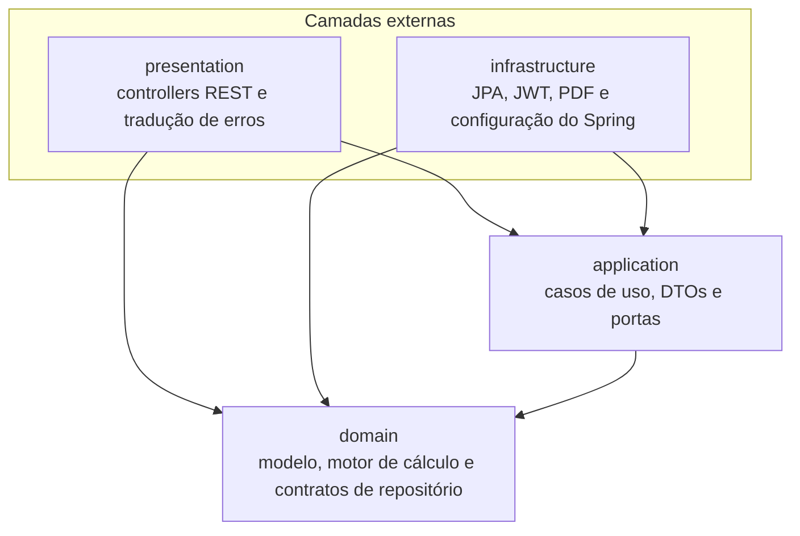
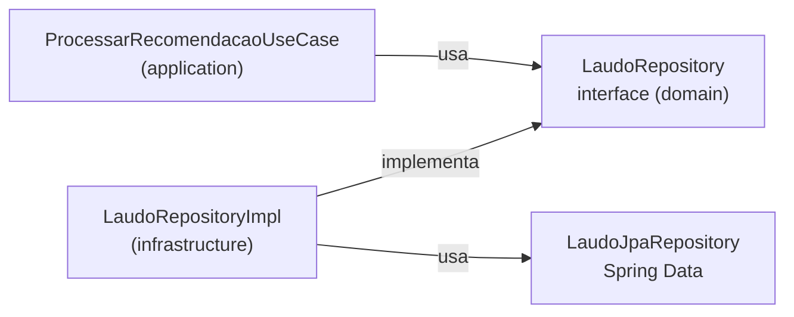
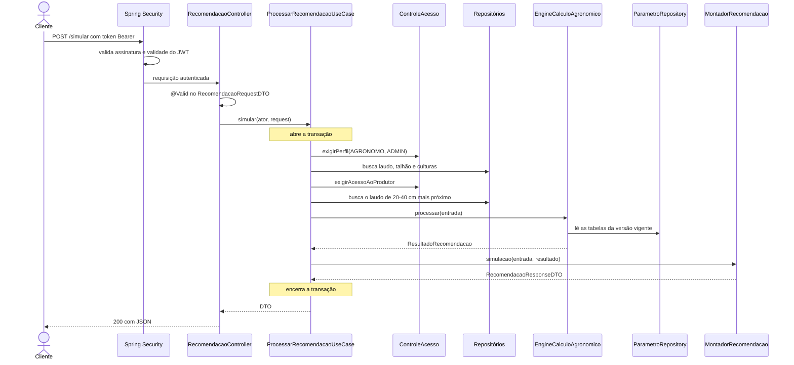

# Arquitetura do backend

## 1. O que o backend faz

O fluxo principal do sistema tem cinco passos:

1. O usuário cadastra a propriedade, o talhão (a área de plantio) e o laudo de solo.
2. O motor calcula SB, CTC, V% e m% e enquadra os teores em classes de fertilidade.
3. O agrônomo simula cenários: cultura, antecessora, manejo, rendimento esperado e PRNT do calcário.
4. O agrônomo salva e adota uma recomendação, que fica congelada para auditoria.
5. O sistema gera o receituário em PDF e guarda o histórico do talhão.

Os valores agronômicos não estão no código: ficam em tabelas versionadas no banco. Para carregar uma nova edição do manual,
basta inserir uma nova versão, sem recompilar nada.

## 2. Tecnologias

| Tecnologia | Versão | Para que serve aqui |
|---|---|---|
| Java | 21 | Linguagem. `record` e `switch` modernos são muito usados |
| Spring Boot | 3.5.16 | Servidor HTTP, injeção de dependências e configuração |
| Spring Data JPA / Hibernate | gerenciado pelo Boot | Leitura e gravação no banco |
| PostgreSQL | 16 | Banco de dados, com enums nativos, JSONB e trigger |
| Flyway | gerenciado pelo Boot | Cria e evolui o esquema do banco por scripts SQL versionados |
| Spring Security + OAuth2 Resource Server | gerenciado pelo Boot | Autenticação com JWT Bearer |
| BCrypt | via Spring Security | Cifra as senhas |
| Bean Validation | gerenciado pelo Boot | Valida o formato das requisições (`@NotNull`, `@Digits` etc.) |
| springdoc-openapi | 2.8.17 | Gera o Swagger |
| OpenPDF | 3.0.5 | Gera o receituário em PDF |
| JUnit 5 + Spring Test | gerenciado pelo Boot | Testes |
| ArchUnit | 1.5.1 | Testa as regras de arquitetura |
| zonky embedded-postgres | 2.2.2 (binários 16.15) | PostgreSQL real, sem Docker, para testes e execução local |

## 3. Clean Architecture em quatro camadas

O código segue a Clean Architecture. A ideia central é a **Regra de Dependência**: as dependências apontam sempre para o centro.
As regras agronômicas ficam no centro e não sabem que existem HTTP, Spring ou banco de dados. Assim, é possível testar o cálculo
em memória e trocar o framework sem reescrever a regra de negócio.



| Camada | Pacote | Responsabilidade | Pode depender de |
|---|---|---|---|
| Domínio | `domain` | Conceitos agronômicos, validações e cálculo | Somente Java |
| Aplicação | `application` | Orquestra cada operação do sistema: permissão, busca de dados, chamada ao motor e gravação | Domínio e Bean Validation |
| Apresentação | `presentation` | Recebe HTTP, converte JSON e traduz exceções em respostas | Aplicação e domínio |
| Infraestrutura | `infrastructure` | Implementa os contratos e configura o Spring | Aplicação e domínio |

### Como a inversão de dependência funciona

O caso de uso precisa ler do banco, mas não pode conhecer o JPA. Por isso, o domínio declara uma interface e a infraestrutura
a implementa:



Na execução, o Spring injeta `LaudoRepositoryImpl`. O caso de uso só conhece a interface. Isso permite que os testes do motor usem
`ParametrosEmMemoria`, uma implementação simples sem banco.

### Como as regras são garantidas

As regras não dependem de disciplina: [`ArquiteturaTest`](../src/test/java/br/edu/tcc/agromotor/ArquiteturaTest.java) faz o build falhar se
alguma for violada.

| Regra | O que proíbe |
|---|---|
| `camadas` | Acessos fora da direção permitida. Por exemplo, o domínio chamar a aplicação |
| `dominioSemFrameworks` | Domínio usar Spring, Jakarta, Hibernate ou Jackson |
| `aplicacaoSemSpringNemJpa` | Aplicação usar Spring, `jakarta.persistence` ou Hibernate |
| `semFlutuantesNoMotor` | Campos `double`, `float`, `Double` ou `Float` no domínio |
| `motorSemConversaoFlutuante` | Domínio chamar método que receba ou devolva `double` ou `float` |

As regras de `float` e `double` existem porque esses tipos não representam valores decimais com exatidão: em binário, `0.1` não é exatamente
um décimo. Em cálculo de dose, todo valor usa `BigDecimal`.

## 4. Estrutura de pastas

```text
TCC-BACK/
├── pom.xml, mvnw, Dockerfile
├── docs/                         esta documentação
└── src/
    ├── main/
    │   ├── java/br/edu/tcc/agromotor/
    │   │   ├── AgroMotorApplication.java
    │   │   ├── domain/
    │   │   │   ├── model/            entidades e objetos de valor
    │   │   │   │   ├── calculo/      entrada e resultados do motor
    │   │   │   │   └── parametro/    linhas das tabelas NEPAR
    │   │   │   ├── repository/       contratos de acesso a dados
    │   │   │   ├── service/          motor de cálculo
    │   │   │   └── exception/
    │   │   ├── application/
    │   │   │   ├── usecase/          operações do sistema, por assunto
    │   │   │   ├── dto/              contrato de entrada e saída da API
    │   │   │   ├── port/             contratos de serviços externos
    │   │   │   └── exception/
    │   │   ├── presentation/
    │   │   │   ├── controller/       rotas REST
    │   │   │   └── exception/        tradução de exceções em HTTP
    │   │   └── infrastructure/
    │   │       ├── config/           segurança, JWT, transação e beans
    │   │       ├── persistence/      implementações dos repositórios
    │   │       │   ├── entity/       mapeamento das tabelas
    │   │       │   └── jpa/          interfaces do Spring Data
    │   │       ├── parametric/       leitura das tabelas NEPAR
    │   │       ├── pdf/              receituário
    │   │       └── demo/             dados de demonstração
    │   └── resources/
    │       ├── application.properties
    │       ├── application-demo.properties
    │       └── db/migration/         V1 a V6 (Flyway)
    └── test/
        ├── java/.../                 testes de unidade, de integração e de arquitetura
        └── resources/validacao/      casos de controle em CSV
```

## 5. O caminho de uma requisição

Exemplo: `POST /api/v1/recomendacoes/simular`, que calcula uma recomendação sem gravar nada.



Os erros seguem o caminho inverso: qualquer exceção sobe até `GlobalExceptionHandler`, que a traduz em uma resposta HTTP.

## 6. Como o Spring monta tudo sem contaminar as camadas internas

Os casos de uso não têm `@Service` nem `@Transactional`, porque a camada de aplicação não pode depender do Spring. Três peças resolvem isso:

| Peça | O que faz |
|---|---|
| [`@UseCase`](../src/main/java/br/edu/tcc/agromotor/application/usecase/UseCase.java) | Anotação criada no próprio projeto, sem nenhuma dependência do Spring |
| [`UseCaseConfig`](../src/main/java/br/edu/tcc/agromotor/infrastructure/config/UseCaseConfig.java) | Procura as classes com `@UseCase` e as registra como beans. Também cria o bean de `EngineCalculoAgronomico` |
| [`TransacaoCasoDeUsoConfig`](../src/main/java/br/edu/tcc/agromotor/infrastructure/config/TransacaoCasoDeUsoConfig.java) | Abre uma transação em cada chamada a um método público de classe com `@UseCase` |

Consequências práticas:

- Toda chamada a um caso de uso é atômica: se algo falhar no meio, nada é gravado.
- Quando um caso de uso chama outro, os dois participam da mesma transação.
- `spring.jpa.open-in-view=false` faz o acesso ao banco terminar junto com o caso de uso, sem consultas durante a escrita do JSON.

### Portas e adaptadores

As portas são interfaces declaradas nas camadas internas para tudo o que depende de tecnologia. Cada uma tem um adaptador na infraestrutura.

| Porta (interface) | Adaptador | Tecnologia |
|---|---|---|
| `UsuarioRepository` | `UsuarioRepositoryImpl` | JPA |
| `PropriedadeRepository` | `PropriedadeRepositoryImpl` | JPA |
| `TalhaoRepository` | `TalhaoRepositoryImpl` | JPA |
| `LaudoRepository` | `LaudoRepositoryImpl` | JPA |
| `CulturaRepository` | `CulturaRepositoryImpl` | JPA |
| `RecomendacaoRepository` | `RecomendacaoRepositoryImpl` | JPA + JSONB |
| `ParametroRepository` | `ParametroRepositoryJpa` | JPA |
| `CifradorSenha` | bean em `SenhaConfig` | BCrypt |
| `GeradorToken` | bean em `JwtConfig` | Nimbus JWT |
| `GeradorReceituario` | `OpenPdfGeradorReceituario` | OpenPDF |
| `ModoDemonstracao` | beans em `ModoDemonstracaoConfig` | Perfil do Spring |

## 7. Segurança

A segurança tem duas etapas, em lugares diferentes:

| Etapa | Onde fica | Pergunta |
|---|---|---|
| Autenticação | `SecurityConfig` e `JwtConfig` | Quem é você? O token é válido? |
| Autorização | Casos de uso, com `ControleAcesso` | Seu perfil pode fazer isso? Esse dado está no seu escopo? |

A autorização fica nos casos de uso porque depende de regra de negócio: para saber se um agrônomo pode ver um laudo, é preciso consultar
o talhão, o produtor dono e os vínculos. Por isso, os testes conseguem cobrir essas regras pela API real.

### O token

- O login devolve um JWT assinado com HMAC-SHA256 (HS256).
- `sub` guarda o id do usuário, `perfil` guarda o perfil e `iss` é `agromotor`.
- Validade padrão: 480 minutos (8 horas), ajustável em `JWT_EXPIRATION_MINUTES`.
- `JWT_SECRET` deve ter ao menos 32 bytes; com menos, a aplicação não inicia. Sem a variável, um segredo aleatório é gerado a cada
  inicialização, e os tokens anteriores deixam de valer quando o backend reinicia.
- A API não guarda sessão (`STATELESS`), e o CSRF fica desligado porque não há cookie de autenticação.
- `UsuarioAutenticadoResolver` extrai id e perfil do token e os entrega ao controller como `UsuarioAutenticado`.

### Quem vê o quê

`ControleAcesso.escopo` define os produtores visíveis para o usuário:

| Perfil | Escopo |
|---|---|
| `ADMIN` | Todos os produtores |
| `AGRONOMO` | Os produtores vinculados a ele em `agronomo_produtor` |
| `PRODUTOR` | Apenas ele mesmo |

Regras adicionais do produtor e a matriz de permissão por rota estão em [API, seção 3](04-api.md#3-permissões-por-rota).

## 8. Tratamento de erros

As camadas internas lançam exceções com significado de negócio, sem conhecer códigos HTTP.
[`GlobalExceptionHandler`](../src/main/java/br/edu/tcc/agromotor/presentation/exception/GlobalExceptionHandler.java) faz a tradução para
Problem Details (RFC 9457), com a lista `erros` que a interface mostra ao usuário.

| Exceção | Lançada por | HTTP | Título |
|---|---|---|---|
| `MethodArgumentNotValidException` | Bean Validation, no `@Valid`. Também preenche `campos` | 400 | Dados inválidos |
| `HttpMessageNotReadableException` | JSON malformado ou enum desconhecido. Indica o campo quando é possível identificá-lo | 400 | Requisição malformada |
| `MethodArgumentTypeMismatchException` | Parâmetro de URL com tipo errado | 400 | Requisição malformada |
| `MissingServletRequestParameterException` | Parâmetro obrigatório ausente na URL | 400 | Requisição malformada |
| `IllegalArgumentException` | Argumento inválido sem outro tratamento | 400 | Requisição malformada |
| `CredenciaisInvalidasException` | Login | 401 | Não autenticado |
| Sem token ou com token inválido | `SecurityConfig` | 401 | Não autenticado |
| `AcessoNegadoException` | `ControleAcesso` e casos de uso | 403 | Acesso negado |
| `RecursoNaoEncontradoException` | Casos de uso | 404 | Recurso não encontrado |
| `ConflitoException` | Casos de uso | 409 | Conflito |
| `DataIntegrityViolationException` | Restrições do banco, como `UNIQUE` | 409 | Conflito |
| `RegraNegocioException` | Domínio e casos de uso | 422 | Regra de negócio violada |
| `ParametroAusenteException` | Motor de cálculo | 422 | Parâmetros NEPAR não cadastrados |

A diferença entre 400 e 422: o 400 indica formato incorreto, como campo ausente ou tipo errado; o 422 indica formato correto, mas regra de
negócio violada, como cálcio igual a zero.

Toda mensagem precisa identificar o campo com problema. Por isso, ao criar uma validação em um DTO, escreva o nome do campo em `message`. No frontend,
[`shared/validacao.ts`](../../TCC-FRONT/src/app/shared/validacao.ts) repete os limites de dígitos e usa a propriedade `campos` para marcar o campo recusado.

## 9. Persistência e configuração

### Migrações

O esquema pertence ao Flyway. `spring.jpa.hibernate.ddl-auto=validate` faz o Hibernate apenas conferir se o mapeamento bate com o
banco, sem alterar nada.

| Script | Conteúdo |
|---|---|
| `V1__esquema_base.sql` | DDL da seção 6.2 do SRS: enums, usuários, propriedades, talhões, culturas, laudos, regra NPK e recomendações |
| `V2__tabelas_parametricas_nepar.sql` | Versões e demais tabelas paramétricas |
| `V3__vinculos_e_auditoria.sql` | Vínculos, textura, Zn e B, restrições do laudo, snapshot, autoria e o trigger de imutabilidade |
| `V4__carga_parametros_demonstracao.sql` | Culturas e parâmetros ilustrativos da versão `DEMO-2026.1`, removidos pela V5 |
| `V5__estrutura_do_manual.sql` | Adapta as tabelas à estrutura do manual: doses em faixa, gesso por argila, limite de V% e micronutrientes por classe |
| `V6__parametros_manual_2019.sql` | Dados oficiais do manual, na versão `NEPAR-2019.1` |
| `V7__ph_em_agua.sql` | Método do pH no laudo e classes de pH em H₂O |
| `V8__registro_de_safra.sql` | Colheita e gasto com adubação de cada recomendação adotada |
| `V9__cobre_e_manganes.sql` | Teores, classes e doses de cobre e manganês |
| `V10__grupo_da_cultura_anterior.sql` | Grupo da cultura anterior que não está cadastrada |

### Decisões de mapeamento

- **Entidades JPA separadas do domínio.** `LaudoSolo` é a regra de negócio e `LaudoJpaEntity` é o mapeamento da tabela. Os métodos `de` e `paraDominio`
  fazem a conversão. Isso custa alguma repetição, mas mantém o domínio livre de anotações.
- **Sem `@ManyToOne`.** As entidades guardam o id como `Long`, e os joins são escritos em JPQL. Assim, não há carregamento implícito de dados.
- **Consultas com filtros opcionais** são montadas em `LaudoRepositoryImpl` e `RecomendacaoRepositoryImpl`, sempre com parâmetros nomeados, sem concatenar valores do usuário.

### Variáveis de ambiente

| Variável | Propriedade | Padrão | Uso |
|---|---|---|---|
| `DB_URL` | `spring.datasource.url` | PostgreSQL em `localhost:5432/agromotor` | Endereço do banco |
| `DB_USER` | `spring.datasource.username` | `agromotor` | Usuário do banco |
| `DB_PASSWORD` | `spring.datasource.password` | Veja `application.properties` | Senha do banco |
| `CORS_ORIGINS` | `app.cors.origens` | `http://localhost:4200` | Origens aceitas pelo navegador |
| `JWT_SECRET` | `app.jwt.segredo` | vazio (segredo aleatório) | Assinatura dos tokens |
| `JWT_EXPIRATION_MINUTES` | `app.jwt.expiracao-minutos` | `480` | Validade do token |
| `ADMIN_EMAIL` e `ADMIN_PASSWORD` | `app.admin.email` e `app.admin.senha` | vazios | Criam o primeiro administrador, se ainda não houver um |
| `SPRING_PROFILES_ACTIVE` | perfil do Spring | nenhum (`demo` no Docker Compose) | `demo` carrega dados fictícios |

### Perfil `demo`

Ativa `DemoDataLoader`, que preenche um banco vazio com contas, propriedades, laudos e recomendações fictícios, e expõe as contas de exemplo
em `GET /sistema/info` para a tela de login. Fora desse perfil, a lista de contas vem vazia. **Não ative esse perfil em produção**, pois as contas são públicas.

### Formas de executar

```bash
# PostgreSQL embutido e dados de demonstração, sem Docker. Dados em ~/.agromotor/pgdata
./mvnw spring-boot:test-run
```

```bash
# Testes: unidade, integração e arquitetura
./mvnw test
```

```bash
# Tudo em contêineres, a partir da raiz do repositório
docker compose up -d --build
```

## 10. Catálogo de todas as classes

### Raiz

| Classe | Objetivo |
|---|---|
| `AgroMotorApplication` | Ponto de entrada: inicia o Spring Boot |

### `domain.model`: conceitos do negócio

Detalhes em [Model](02-model.md).

| Classe | Tipo | Objetivo |
|---|---|---|
| `Usuario` | record | Conta de acesso, com validação dos dados obrigatórios |
| `Propriedade` | record | Propriedade rural de um produtor; recusa UF diferente de PR |
| `Talhao` | record | Área de plantio de uma propriedade; exige área positiva |
| `ContextoTalhao` | record | Talhão com os dados da propriedade e do produtor, para consultas e controle de acesso |
| `LaudoSolo` | record | Laudo de uma camada do solo; valida os limites e deriva os indicadores |
| `IndicadoresSolo` | record | SB, t, T, V% e m%, com as fórmulas e o arredondamento |
| `Cultura` | record | Cultura e seus requisitos: V2, pH ideal e grupo botânico |
| `Recomendacao` | record | Recomendação registrada; controla a transição SIMULACAO → ADOTADA |
| `VersaoParametros` | record | Identifica a versão das tabelas usada em um cálculo |
| `EscopoProdutores` | record | Conjunto de produtores que um usuário pode ver |
| `FiltroLaudos` | record | Filtros opcionais da consulta de laudos |
| `FiltroRecomendacoes` | record | Filtros opcionais da consulta de recomendações |
| `FaixaDose` | record | Dose como o manual a apresenta: mínimo e máximo, em kg/ha |
| `Decimais` | classe utilitária | Arredondamento, percentual, comparação e formatação de `BigDecimal` |
| `Validacao` | classe auxiliar | Acumula erros para informar todos de uma vez |
| `PerfilUsuario` | enum | `ADMIN`, `AGRONOMO`, `PRODUTOR` |
| `StatusRecomendacao` | enum | `SIMULACAO`, `ADOTADA` |
| `SistemaManejo` | enum | `PLANTIO_DIRETO`, `CONVENCIONAL` |
| `GrupoBotanico` | enum | `LEGUMINOSA`, `GRAMINEA`; define a fixação biológica e o ajuste de N |
| `ProfundidadeAmostra` | enum | Camada de `0-20` ou `20-40` cm |
| `TexturaSolo` | enum | Textura informada no cadastro do talhão |
| `Micronutriente` | enum | `ZINCO`, `BORO`, `COBRE`, `MANGANES` |
| `NutrienteNpk` | enum | `N`, `P2O5`, `K2O`: o nutriente de uma célula das tabelas de dose |
| `AtributoSolo` | enum | Atributos do laudo que têm classe de fertilidade, com rótulo e unidade |

### `domain.model.calculo`: entrada e saída do motor

| Classe | Objetivo |
|---|---|
| `EntradaRecomendacao` | Cenário completo do cálculo, com validação |
| `ResultadoRecomendacao` | Recomendação completa: indicadores, doses, avisos, memória e versão |
| `ResultadoCalagem` | Dose de calcário, NC calculada e justificativas |
| `ResultadoGessagem` | Se foi avaliada, se é necessária, dose e motivo |
| `ResultadoAdubacao` | Faixas de dose de N, P₂O₅ e K₂O, classes e justificativas |
| `ResultadoMicronutriente` | Avaliação e dose de um micronutriente |
| `InterpretacaoAtributo` | Classe de fertilidade de um atributo do laudo |

### `domain.model.parametro`: linhas das tabelas NEPAR

| Classe | Tabela | Objetivo |
|---|---|---|
| `Intervalo` | | Faixa semiaberta `[min, max)` usada em todas as tabelas |
| `FaixaInterpretacao` | `nepar_faixa_interpretacao` | Faixa de teor que define uma classe de fertilidade |
| `RegraNpk` | `nepar_regra_npk` | Célula das tabelas de dose: nutriente, classe, cultura anterior, rendimento e faixa, ou "Inviável" |
| `RegraCalagem` | `nepar_regra_calagem` | Forma de aplicação do calcário por manejo |
| `RegraGessagem` | `nepar_regra_gessagem` | Critérios do gesso: saturação por alumínio e cálcio |
| `DoseGesso` | `nepar_dose_gesso` | Dose de gesso por faixa de argila |
| `RegraMicronutriente` | `nepar_regra_micronutriente` | Dose de Zn ou B conforme a classe no solo |

### `domain.service`: motor de cálculo

Detalhes em [Services](03-services.md#parte-1-motor-de-cálculo).

| Classe | Objetivo |
|---|---|
| `EngineCalculoAgronomico` | Orquestra os cálculos, reúne pendências e monta avisos e memória |
| `CalculadorAgronomico` | Interface da estratégia de cálculo (padrão Strategy) |
| `CalculadorCalagem` | Necessidade de calcário pela saturação por bases, a partir do limite de V% da cultura |
| `CalculadorGessagem` | Indicação e dose de gesso pela camada de 20-40 cm |
| `CalculadorAdubacaoNPK` | Faixas de dose de N, P₂O₅ e K₂O, ou recusa do cenário |
| `CalculadorMicronutrientes` | Dose de Zn, B, Cu e Mn pela classe no solo |
| `ClassificadorFertilidade` | Enquadra teores em classes de fertilidade |

### `domain.repository`: contratos de dados

| Interface | Objetivo |
|---|---|
| `UsuarioRepository` | Contas e vínculos agrônomo-produtor |
| `PropriedadeRepository` | Propriedades visíveis ao usuário |
| `TalhaoRepository` | Talhões e seu contexto |
| `LaudoRepository` | Laudos e consultas com filtro |
| `CulturaRepository` | Leitura de culturas |
| `RecomendacaoRepository` | Recomendações, consulta com filtro e última adoção do talhão |
| `ParametroRepository` | Leitura das tabelas paramétricas da versão vigente |

### `domain.exception`

| Classe | Objetivo |
|---|---|
| `RegraNegocioException` | Dados que violam regras do domínio; guarda a lista de erros |
| `ParametroAusenteException` | Tabelas não cobrem o caso calculado; guarda a lista de pendências |

### `application.usecase`: operações do sistema

Detalhes em [Services](03-services.md#parte-2-casos-de-uso).

| Classe | Objetivo |
|---|---|
| `UseCase` | Anotação que marca um caso de uso |
| `ControleAcesso` | Calcula o escopo do usuário e verifica perfil e acesso |
| `AutenticarUsuarioUseCase` | Login e emissão do token |
| `RegistrarUsuarioUseCase` | Cadastro público de produtor ou agrônomo |
| `CriarContaUsuario` | Regra comum de criação de conta: e-mail único e senha cifrada |
| `GerenciarUsuariosUseCase` | Listar, criar, atualizar e excluir usuários |
| `GerenciarVinculosUseCase` | Criar, listar e remover vínculos agrônomo-produtor |
| `GerenciarPropriedadesUseCase` | CRUD de propriedades |
| `GerenciarTalhoesUseCase` | CRUD de talhões |
| `CadastrarLaudoUseCase` | Registra um laudo e devolve a interpretação |
| `ConsultarLaudosUseCase` | Lista e detalha laudos |
| `ExcluirLaudoUseCase` | Exclui um laudo que não tenha recomendações |
| `CalcularIndicadoresUseCase` | Prévia de SB, t, T, V% e m%, sem gravar |
| `ProcessarRecomendacaoUseCase` | Simula em memória ou registra como SIMULACAO |
| `AdotarRecomendacaoUseCase` | Passa uma recomendação para ADOTADA |
| `ConsultarRecomendacoesUseCase` | Lista, detalha, descarta simulação e sugere a antecessora |
| `MontadorRecomendacao` | Converte cenário e resultado em `RecomendacaoResponseDTO` |
| `GerarReceituarioUseCase` | Gera o PDF de uma recomendação adotada |
| `ConsultarHistoricoTalhaoUseCase` | Monta a linha do tempo do talhão |
| `GerarDashboardEvolucaoUseCase` | Monta as séries dos gráficos de um talhão |
| `GerarResumoPainelUseCase` | Monta os indicadores do painel inicial |
| `ConsultarParametrosUseCase` | Mostra versão, culturas e tabelas vigentes |

### `application.port` e `application.exception`

| Classe | Objetivo |
|---|---|
| `CifradorSenha` | Contrato para cifrar e conferir senhas |
| `GeradorToken` | Contrato para emitir o token de acesso |
| `GeradorReceituario` | Contrato para gerar o PDF |
| `ModoDemonstracao` | Contrato que informa as contas de exemplo |
| `AcessoNegadoException` | Operação sem permissão (403) |
| `ConflitoException` | Conflito com o estado dos dados (409) |
| `CredenciaisInvalidasException` | E-mail ou senha inválidos (401) |
| `RecursoNaoEncontradoException` | Registro não encontrado (404) |

### `application.dto`: contrato da API

Os campos estão em [API](04-api.md).

| Classe | Objetivo |
|---|---|
| `LoginRequest`, `TokenResponse` | Entrada e saída do login |
| `UsuarioRequest`, `UsuarioAtualizacaoRequest`, `UsuarioResponse` | Criação, atualização e leitura de usuários |
| `UsuarioAutenticado` | Identidade extraída do token, repassada aos casos de uso |
| `VinculoRequest`, `VinculoResponse` | Vínculo agrônomo-produtor |
| `PropriedadeRequest`, `PropriedadeResponse` | Propriedade |
| `TalhaoRequest`, `TalhaoResponse` | Talhão |
| `LaudoRequest`, `LaudoResponse` | Laudo e sua interpretação |
| `IndicadoresRequest` | Entrada da prévia de indicadores |
| `CulturaResponse` | Cultura |
| `RecomendacaoRequestDTO`, `RecomendacaoResponseDTO` | Contrato da simulação e da recomendação (SRS 8.1) |
| `SugestaoAntecessoraResponse` | Última cultura adotada no talhão |
| `HistoricoTalhaoResponse` | Linha do tempo do talhão |
| `EvolucaoResponse` | Séries dos gráficos |
| `ResumoPainelResponse` | Indicadores do painel |
| `ParametrosVigentesResponse` | Conteúdo da versão vigente das tabelas |
| `SistemaInfoResponse` | Versão vigente e contas de demonstração |

### `presentation`

| Classe | Objetivo |
|---|---|
| `AuthController` | `/auth`: login, registro e perfil próprio |
| `UsuarioController` | `/usuarios` e `/vinculos` |
| `PropriedadeController` | `/propriedades` e `/talhoes`, incluindo histórico e sugestão de antecessora |
| `LaudoController` | `/laudos` |
| `RecomendacaoController` | `/recomendacoes` |
| `RelatorioController` | `/relatorios/receituario/{id}` |
| `DashboardController` | `/dashboard` |
| `ParametroController` | `/sistema/info`, `/culturas` e `/parametros/vigentes` |
| `UsuarioAutenticadoResolver` | Faz o controller receber `UsuarioAutenticado` como parâmetro |
| `GlobalExceptionHandler` | Traduz exceções em respostas HTTP |

### `infrastructure.config`

| Classe | Objetivo |
|---|---|
| `SecurityConfig` | Rotas públicas, JWT, CORS e respostas 401 e 403 |
| `JwtConfig` | Chave, codificador, decodificador e geração do token |
| `SenhaConfig` | Implementa `CifradorSenha` com BCrypt |
| `UseCaseConfig` | Registra casos de uso e o motor como beans |
| `TransacaoCasoDeUsoConfig` | Abre transação em cada caso de uso |
| `OpenApiConfig` | Título do Swagger e autenticação Bearer |
| `AdministradorInicial` | Cria o primeiro administrador a partir das variáveis de ambiente |

### `infrastructure.persistence`

| Classe | Objetivo |
|---|---|
| `UsuarioRepositoryImpl` | Implementa `UsuarioRepository` |
| `PropriedadeRepositoryImpl` | Implementa `PropriedadeRepository` |
| `TalhaoRepositoryImpl` | Implementa `TalhaoRepository`, com a consulta de contexto |
| `LaudoRepositoryImpl` | Implementa `LaudoRepository`, com filtros e escopo |
| `CulturaRepositoryImpl` | Implementa `CulturaRepository` |
| `RecomendacaoRepositoryImpl` | Implementa `RecomendacaoRepository` e lê e grava o snapshot em JSON |
| `UsuarioJpaEntity`, `PropriedadeJpaEntity`, `TalhaoJpaEntity`, `LaudoJpaEntity`, `CulturaJpaEntity`, `RecomendacaoJpaEntity`, `VinculoJpaEntity` | Mapeiam uma tabela cada; veja [Model, seção 9](02-model.md#9-do-domínio-ao-banco) |
| `UsuarioJpaRepository`, `PropriedadeJpaRepository`, `TalhaoJpaRepository`, `LaudoJpaRepository`, `CulturaJpaRepository`, `RecomendacaoJpaRepository`, `VinculoJpaRepository` | Interfaces do Spring Data, com as consultas por nome de método |

### `infrastructure.parametric`

| Classe | Objetivo |
|---|---|
| `ParametroRepositoryJpa` | Implementa `ParametroRepository`; toda consulta filtra pela versão vigente |
| `VersaoParametrosJpaEntity`, `FaixaInterpretacaoJpaEntity`, `RegraNpkJpaEntity`, `RegraCalagemJpaEntity`, `RegraGessagemJpaEntity`, `DoseGessoJpaEntity`, `RegraMicronutrienteJpaEntity` | Mapeiam as tabelas paramétricas e as convertem em objetos de domínio |

### `infrastructure.pdf` e `infrastructure.demo`

| Classe | Objetivo |
|---|---|
| `OpenPdfGeradorReceituario` | Desenha o receituário em A4: aviso de teste, identificação, laudo, recomendação proposta, justificativas, avisos, assinatura e memória de cálculo |
| `DemoDataLoader` | Popula o banco vazio com dados fictícios no perfil `demo`, gerando as recomendações pelo motor real |
| `ModoDemonstracaoConfig` | Fornece as contas de exemplo no perfil `demo` e uma lista vazia nos demais |

### Testes

| Classe | O que verifica |
|---|---|
| `ArquiteturaTest` | As regras de dependência e a ausência de tipos flutuantes |
| `LaudoSoloTest` | Indicadores e validações do laudo |
| `RecomendacaoTest` | Adoção e recusa da segunda adoção |
| `CalculadorCalagemTest` | Fórmula da NC (incluindo o teste literal do SRS, com V2 = 70 e NC = 1,97), PRNT, limite de V% da cultura, pH baixo e regra ausente |
| `CalculadorGessagemTest` | Cada critério, os valores exatamente no limite, as faixas de argila e a falta de laudo |
| `CalculadorAdubacaoNPKTest` | Faixas de dose, classes independentes, argila, % de K na CTC, cultura anterior, M.O., pousio, "Inviável" e faixas sobrepostas |
| `CalculadorMicronutrientesTest` | Dose por classe, classe Muito baixo, sem teor e cultura sem dose no manual |
| `EngineCalculoAgronomicoTest` | Cenário do exemplo, memória de cálculo, reunião de pendências e entrada inalterada |
| `CasosControleTest` | Compara o motor com o CSV gerado de forma independente por `docs/validacao/gerar_casos_controle.py` |
| `FluxoRecomendacaoIntegracaoTest` | Fluxo completo pela API, indicação dos campos com erro, snapshot imutável, nova versão de parâmetros e desempenho |
| `SegurancaIntegracaoTest` | Autenticação, isolamento entre usuários, vínculos e permissões |
| `ModoDemonstracaoIntegracaoTest` | Carga de dados do perfil `demo` |
| `ManualNeparIntegracaoTest` | Os dados publicados do manual pela API, nas três culturas, e a leitura de recomendações anteriores à V5 |

Classes de apoio aos testes:

| Classe | Objetivo |
|---|---|
| `BancoEmbutido` | Sobe o PostgreSQL embutido, descartável nos testes e persistente na execução local |
| `TestAgroMotorApplication` | Ponto de entrada de `./mvnw spring-boot:test-run` |
| `IntegracaoBase` | Base dos testes de integração, com usuários e dados prontos |
| `LaudoSoloBuilder` | Monta laudos de teste com valores padrão |
| `ParametrosEmMemoria` | `ParametroRepository` em memória para testar o motor sem banco |

## 11. Limitações conhecidas

São pontos a considerar antes de um uso real. Nenhum deles impede a demonstração do sistema.

| Ponto | Situação atual |
|---|---|
| Validação agronômica | As tabelas são as do manual, mas a comparação com 50 a 100 laudos reais prevista no TCC ainda não foi feita |
| Dose em faixa | O sistema mostra a faixa do manual. A definição dentro dela fica com o agrônomo e não é registrada no sistema |
| Cadastro público de agrônomo | Qualquer pessoa pode se registrar como agrônomo em `/auth/registro`. O CREA é opcional e não é verificado, mas esse agrônomo só acessa produtores que o autorizarem |
| Revogação de token | Um token continua válido até expirar, mesmo depois que a conta for excluída ou a senha trocada |
| Limite de tentativas de login | Não há bloqueio nem limite de tentativas |
| Rendimento esperado | A API aceita qualquer valor positivo com até 3 dígitos inteiros. Como a última coluna do manual não tem limite ("> 5"), 500 t/ha de soja cai nela e não gera erro |
| Imutabilidade dos parâmetros | O trigger protege recomendações adotadas, mas nada impede alterar por SQL as linhas de uma versão já usada. Para mudar valores, publique uma nova versão |
| Paginação | As listagens devolvem todos os registros visíveis, sem paginação |
