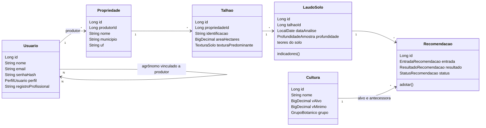
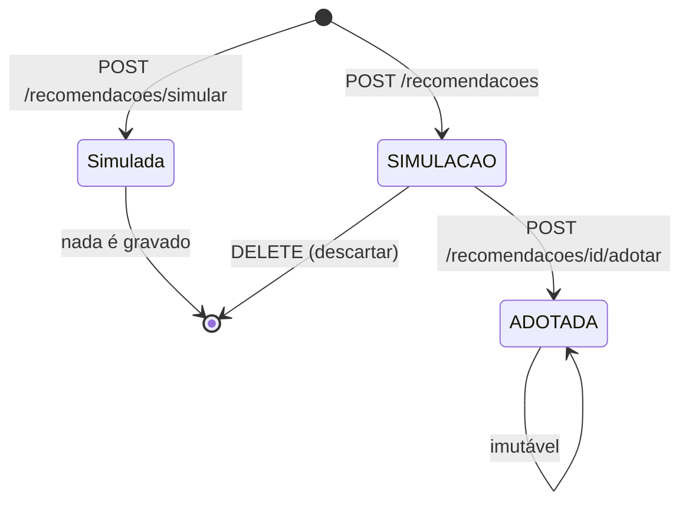
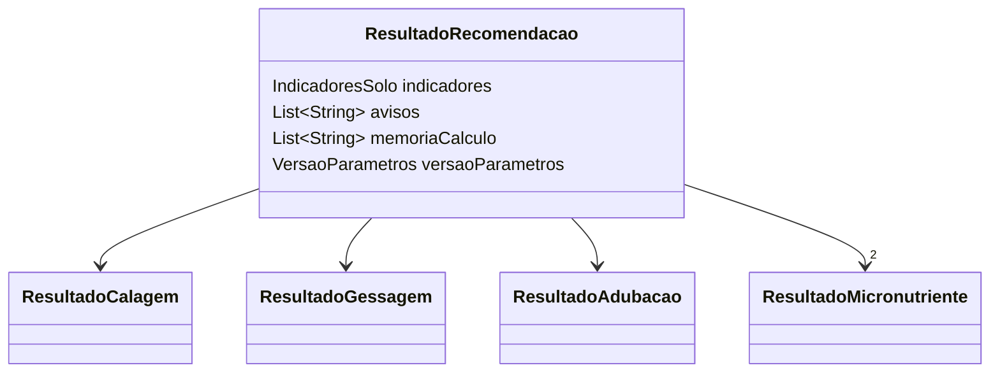
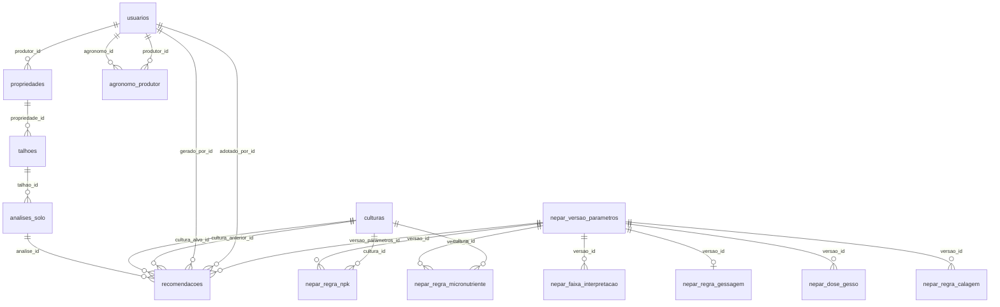

# Model

Neste documento, "model" significa o modelo de domínio (`domain.model`): os objetos que representam os conceitos do negócio. No fim,
a [seção 9](#9-do-domínio-ao-banco) mostra como eles se transformam em tabelas.

Os DTOs, que são o formato do JSON da API, estão em [API](04-api.md).

## 1. Glossário

### Agronômico

| Termo | Significado |
|---|---|
| Talhão | Parte da propriedade tratada como uma unidade de plantio e manejo |
| Laudo | Resultado da análise de solo feita em laboratório, referente a uma camada |
| Camada 0-20 cm | Solo superficial. Base da calagem e do NPK |
| Camada 20-40 cm | Subsuperfície. Base da gessagem |
| Calagem | Aplicação de calcário para corrigir a acidez e elevar a saturação por bases |
| Gessagem | Aplicação de gesso para reduzir o alumínio tóxico e levar cálcio às camadas profundas |
| Adubação NPK | Fornecimento de nitrogênio (N), fósforo (P₂O₅) e potássio (K₂O) |
| PRNT | Poder Relativo de Neutralização Total: a eficiência do calcário, em % |
| SB | Soma de bases: Ca + Mg + K |
| t | CTC efetiva: SB + Al |
| T | CTC a pH 7,0: SB + (H+Al) |
| V% (V1) | Saturação por bases atual: SB / T × 100 |
| V2 | Saturação por bases desejada pela cultura |
| m% | Saturação por alumínio: Al / t × 100 |
| NC | Necessidade de calagem, em t/ha |
| NG | Necessidade de gesso, em kg/ha |
| M.O. | Matéria orgânica |
| FBN | Fixação Biológica de Nitrogênio: a leguminosa obtém N do ar por meio de bactérias, sem precisar de N mineral |
| Cultura antecessora | Cultura da safra anterior. Altera a necessidade de N |
| Pousio/palhada | Sem cultura antecessora. No sistema, `culturaAnterior` e `grupoAnteriorInformado` nulos. O manual só traz dose para esse caso na soja |
| Classe de fertilidade | Nível do teor no solo, de "Muito baixo" a "Condição a evitar", segundo as tabelas do manual |
| Faixa de dose | Forma como o manual apresenta N, P₂O₅ e K₂O: um mínimo e um máximo, como 61 a 80 kg/ha |
| "Inviável" | Célula de uma tabela de dose em que o manual considera a produtividade inatingível naquele solo |
| Plantio Direto | Semeadura sem revolver o solo |
| Receituário | Documento com a recomendação proposta, adotada pelo engenheiro agrônomo |

### Técnico

| Termo | Significado |
|---|---|
| `record` | Classe imutável do Java: os campos são definidos uma vez e não mudam |
| Construtor compacto | Bloco `public LaudoSolo { ... }` de um record. Roda ao criar o objeto; aqui, é onde a validação acontece |
| Objeto de valor | Objeto definido só pelo conteúdo, como `IndicadoresSolo` |
| Snapshot | Cópia congelada dos dados de um momento |
| Versão vigente | A única versão das tabelas paramétricas que o motor lê |

### Por que tudo é imutável

Quase tudo no modelo é `record`. Para "alterar" um objeto, cria-se outro: `Recomendacao.adotar` devolve uma nova recomendação, e `Usuario.comSenha`,
um novo usuário. O motor recebe a entrada e devolve o resultado sem efeitos colaterais, o que torna o cálculo previsível e fácil de testar.
O teste `naoAlteraEntrada` verifica isso.

Como a validação fica no construtor, **não é possível existir um `LaudoSolo` inválido**.

## 2. Mapa das entidades



As referências entre os objetos são ids (`Long`), não objetos aninhados. A exceção é `EntradaRecomendacao`, que guarda o laudo e as culturas completos porque faz parte do snapshot.

## 3. Entidades

### `Usuario`

Conta de acesso. Campos obrigatórios: nome, e-mail, hash da senha e perfil.

| Campo | Descrição |
|---|---|
| `senhaHash` | Hash BCrypt. A senha em texto nunca é guardada nem devolvida pela API |
| `perfil` | Definido na criação. A API não oferece forma de alterá-lo |
| `registroProfissional` | CREA, opcional. Aparece na assinatura do receituário |

Métodos: `comDados(nome, email, registro)` e `comSenha(hash)` devolvem uma cópia alterada.

### `Propriedade`

Propriedade rural de um produtor. A constante `UF_ATENDIDA = "PR"` e a validação recusam outro estado, porque o manual de referência vale para o Paraná.
A tabela tem a mesma restrição (`ck_propriedades_uf`).

### `Talhao`

| Campo | Regra |
|---|---|
| `identificacao` | Obrigatória. Única dentro da propriedade (restrição `uk_talhoes_identificacao`) |
| `areaHectares` | Maior que zero. Usada para calcular o total a aplicar no receituário |
| `texturaPredominante` | Opcional e informativa: `LEVE`, `MEDIA`, `ARGILOSA` ou `MUITO_ARGILOSA`. **Não entra no cálculo**, que usa a argila do laudo |

`ContextoTalhao` é uma visão de leitura que junta o talhão à propriedade e ao produtor. O campo `produtorId` é o que os casos de uso usam para verificar o acesso.

### `LaudoSolo`

Laudo de uma camada. Ao ser criado, valida os dados e reporta **todos** os erros de uma vez.

| Campo | Unidade | Regra |
|---|---|---|
| `talhaoId`, `dataAnalise`, `profundidade` | | Obrigatórios |
| `ph` | pH do laudo | Obrigatório, de 3,0 a 9,0 |
| `metodoPh` | Método do pH: `CACL2` ou `AGUA` | Obrigatório. Só define a classe mostrada |
| `moGDm3` | g/dm³ | Obrigatório, maior que zero |
| `pMehlich` | mg/dm³ | Obrigatório, maior que zero |
| `kCmolc`, `caCmolc`, `mgCmolc` | cmolc/dm³ | Obrigatórios, maiores que zero |
| `alCmolc` | cmolc/dm³ | Obrigatório, **zero é aceito** |
| `hAlCmolc` | cmolc/dm³ | Obrigatório, maior que zero |
| `argilaPorcentagem` | % | Obrigatório, de 0 a 100 |
| `znMgDm3`, `bMgDm3`, `cuMgDm3`, `mnMgDm3` | mg/dm³ | Opcionais, não negativos |

O SRS pede "teores > 0", mas alumínio igual a zero é um resultado comum em solo já corrigido. Essa decisão está registrada em `docs/rastreabilidade.md`.

| Método | O que faz |
|---|---|
| `somaBases()` | Ca + Mg + K, sem arredondar |
| `ctcTotal()` | SB + (H+Al), sem arredondar |
| `indicadores()` | Devolve `IndicadoresSolo`, com os valores arredondados |
| `saturacaoBasesAbaixoDe(limite)` | Compara o V% exato com um limite, sem arredondamento e sem divisão |
| `saturacaoAluminioAcimaDe(limite)` | Faz o mesmo com o m% |
| `porcentagemKNaCtc()` | K × 100 / T, com uma casa. É o valor que o manual enquadra nas classes de potássio |
| `teor(nutriente)` | Devolve o teor de Zn ou B |

`saturacaoBasesAbaixoDe` compara `100 × SB < limite × T`. Se usasse o V% arredondado, um valor de 49,96% viraria 50,0% e deixaria de acionar a calagem da soja.

### `IndicadoresSolo`

Calcula e guarda os indicadores, a partir de Ca, Mg, K, Al e H+Al:

```text
SB = Ca + Mg + K                 2 casas
t  = SB + Al                     2 casas
T  = SB + (H + Al)               2 casas
V% = SB × 100 / T                1 casa
m% = Al × 100 / t                1 casa
```

**Exemplo (laudo da Tela A do SRS):** Ca 3,20; Mg 1,10; K 0,35; Al 0,10; H+Al 4,80.

```text
SB = 4,65   t = 4,75   T = 9,45   V% = 49,2   m% = 2,1
```

Se o divisor for zero, `Decimais.percentual` devolve 0,0, sem lançar erro.

### `Cultura`

Vem da tabela `culturas` e é preenchida pela carga de parâmetros.

| Campo | Uso |
|---|---|
| `vAlvo` | V2 da fórmula da calagem |
| `vMinimo` | Limite da cultura: o calcário é indicado quando o V% está abaixo dele |
| `phMinIdeal` | Valor em CaCl₂. Se o pH do laudo, medido em CaCl₂, estiver abaixo dele, a calagem fica marcada como necessária |
| `phMaxIdeal` | Só para consulta; não entra no cálculo |
| `grupo` | `LEGUMINOSA` ativa a FBN. Na antecessora, escolhe a linha da tabela de N |

| Cultura | V2 | Limite | pH ideal | Grupo |
|---|---|---|---|---|
| Soja | 60% | 50% | 5,0 a 5,5 | Leguminosa |
| Milho | 70% | 60% | 5,0 a 5,5 | Gramínea |
| Trigo | 70% | 60% | 5,0 a 5,5 | Gramínea |

### `FaixaDose`

Guarda uma dose como o manual a apresenta: `min` e `max`, em kg/ha. O sistema não escolhe um valor dentro da faixa, porque essa decisão é do agrônomo.

| Membro | O que faz |
|---|---|
| Construtor | Arredonda os dois valores para 2 casas |
| `FaixaDose.zero()` | Dose zero, usada no N da soja |
| `descricao()` | Texto para a memória de cálculo: `61,00 a 80,00`, ou `0,00` quando o mínimo é igual ao máximo |

### `Recomendacao`

Registro de um cálculo, com o cenário e o resultado daquele momento.



| Membro | O que faz |
|---|---|
| `Recomendacao.simulacao(...)` | Cria o registro com status `SIMULACAO` |
| `adotar(agronomoId, agora)` | Devolve a cópia `ADOTADA`. Se já estiver adotada, lança `RegraNegocioException` |
| `adotada()` | Informa se o status é `ADOTADA` |

A proteção da adoção existe em três níveis:

1. **Domínio:** `adotar` recusa uma segunda adoção.
2. **Caso de uso:** `excluir` recusa uma recomendação adotada.
3. **Banco:** o trigger `trg_recomendacao_imutavel` recusa `UPDATE` e `DELETE` em linha adotada, mesmo fora da aplicação.

### `VersaoParametros`

Identifica a versão das tabelas usada em um cálculo. O campo `conferidaManual` indica se os valores foram conferidos com o manual. Quando é falso, a tela e o PDF mostram o aviso de valores não conferidos.

A versão vigente é a `NEPAR-2019.1`, conferida. A `DEMO-2026.1` continua cadastrada, sem linhas de parâmetros, só para identificar recomendações antigas que tenham sido feitas com ela.

### `EscopoProdutores`

Representa o que o usuário pode ver. `irrestrito` vale para o administrador; nos outros perfis, o acesso é limitado a `produtorIds`. O método `permite(id)` responde à verificação, e os repositórios usam o escopo para filtrar as consultas.

### `FiltroLaudos` e `FiltroRecomendacoes`

Filtros opcionais de consulta. Campo nulo não restringe. Nas recomendações, o período considera a data de adoção ou, se não houver, a de geração.

## 4. Enumerações

| Enum | Valores | Observação |
|---|---|---|
| `PerfilUsuario` | `ADMIN`, `AGRONOMO`, `PRODUTOR` | Enum nativo no PostgreSQL |
| `StatusRecomendacao` | `SIMULACAO`, `ADOTADA` | Enum nativo |
| `SistemaManejo` | `PLANTIO_DIRETO`, `CONVENCIONAL` | Enum nativo, com rótulo para exibição |
| `GrupoBotanico` | `LEGUMINOSA`, `GRAMINEA` | Enum nativo, com rótulo |
| `ProfundidadeAmostra` | `CAMADA_0_20`, `CAMADA_20_40` | Códigos `0-20` e `20-40`. `deCodigo` converte o texto |
| `TexturaSolo` | `LEVE`, `MEDIA`, `ARGILOSA`, `MUITO_ARGILOSA` | Texto com `CHECK` no banco |
| `Micronutriente` | `ZINCO`, `BORO`, `COBRE`, `MANGANES` | Com símbolo e rótulo |
| `NutrienteNpk` | `N`, `P2O5`, `K2O` | Com rótulo. Identifica o nutriente de uma célula de `RegraNpk` |
| `MetodoPh` | `CACL2`, `AGUA` | Cada método aponta para o seu atributo: `PH` ou `PH_AGUA` |
| `AtributoSolo` | `PH`, `PH_AGUA`, `MATERIA_ORGANICA`, `FOSFORO`, `POTASSIO`, `CALCIO`, `MAGNESIO`, `SATURACAO_BASES`, `SATURACAO_ALUMINIO`, `ZINCO`, `BORO`, `COBRE`, `MANGANES` | Com rótulo e unidade |

As classes de fertilidade, como "Baixo" ou "Médio", são **texto, não enum**. Assim, é possível usar os rótulos exatos do manual sem recompilar.

## 5. Entrada e saída do motor (`domain.model.calculo`)

### `EntradaRecomendacao`

O cenário completo do cálculo:

| Campo | Regra |
|---|---|
| `laudo` | Obrigatório e da camada de 0-20 cm |
| `laudoSubsuperficie` | Opcional e da camada de 20-40 cm. Nulo: gessagem não avaliada |
| `culturaAlvo` | Obrigatória |
| `culturaAnterior` | Opcional. Nula, sem grupo informado: pousio/palhada |
| `grupoAnteriorInformado` | Opcional. Grupo da cultura anterior que não está cadastrada; não pode vir junto com `culturaAnterior` |
| `manejo` | Obrigatório |
| `expectativaRendimentoTonHa` | Obrigatória, maior que zero |
| `prntCalcario` | Obrigatório, maior que zero, no máximo 200 |

`PRNT_PADRAO` (100,0) é usado quando a requisição não informa o PRNT.

### `ResultadoRecomendacao` e seus componentes



| Classe | Campo | Significado |
|---|---|---|
| `ResultadoCalagem` | `necessario` | Verdadeiro se V1 estiver abaixo do limite da cultura ou o pH em CaCl₂, abaixo do ideal |
| | `v2AlvoPorcentagem` | V2 usado |
| | `ncCalculadaTonHa` | Resultado direto da fórmula |
| | `necessidadeCalcarioTonHa` | **Dose final**: igual à fórmula se V1 estiver abaixo do limite; caso contrário, zero |
| | `observacao`, `justificativa` | Forma de aplicação, conforme o manejo, e explicação da dose |
| `ResultadoGessagem` | `avaliada` | Falso se não houver laudo de 20-40 cm |
| | `necessario`, `doseKgHa` | Indicação e dose |
| | `justificativa` | Critérios que foram acionados |
| `ResultadoAdubacao` | `doseNkgHa`, `doseP2O5kgHa`, `doseK2OkgHa` | Faixas de dose (`FaixaDose`) |
| | `classeFosforo`, `classePotassio`, `classeMateriaOrganica` | Classes usadas |
| | `justificativaN`, `justificativaP`, `justificativaK` | Explicações |
| `ResultadoMicronutriente` | `avaliado` | Falso sem teor no laudo ou sem dose no manual para a cultura |
| | `teor`, `classe`, `doseKgHa` | Valores. Classe e dose são nulas se não for avaliado |
| | `previstoNoManual` | Falso quando o manual não traz dose para a cultura. Nesse caso, a falta do teor não gera aviso |
| `InterpretacaoAtributo` | `atributo`, `valor`, `classe` | Classe de um atributo; nula se a tabela não cobrir o valor |

Em `ResultadoRecomendacao`, `avisos` traz o que o usuário deve notar, e `memoriaCalculo`, cada conta feita, para auditoria.

## 6. Tabelas paramétricas (`domain.model.parametro`)

Cada record representa uma linha de tabela. É assim que o motor recebe valores agronômicos sem tê-los no código.

### `Intervalo`

Faixa semiaberta `[min, max)`: `min` entra, `max` não, e limite nulo significa "sem limite". `contem(valor)` faz a verificação.

| Intervalo | 7,99 | 8,00 | 15,99 | 16,00 |
|---|---|---|---|---|
| `[8, 16)` | Não | **Sim** | **Sim** | Não |

Essa convenção faz faixas vizinhas se encaixarem sem sobreposição: `[8, 16)` e `[16, 24)` nunca disputam o mesmo valor.

O manual escreve limites que incluem o próprio valor, como "até 20%". Eles são gravados com 0,01 a mais: `[0; 20,01)`. Quando o livro deixa uma lacuna entre duas faixas, o valor fica na faixa de baixo. As decisões de leitura estão em [`docs/dados-do-manual.md`](../../docs/dados-do-manual.md).

### Demais records

| Record | Campos | Como é usado |
|---|---|---|
| `FaixaInterpretacao` | `atributo`, `criterio`, `teor`, `classe` | `aplicaA(criterio, teor)`. O critério é a argila no P. No K, `teor` é a porcentagem de K na CTC |
| `RegraNpk` | `culturaId`, `nutriente`, `classeFertilidade`, `grupoAntecessor`, `rendimento`, `dose` | Uma célula do manual. `aplicaA(nutriente, classe, antecessor, rendimento)` faz a busca. `inviavel()` é verdadeiro quando `dose` é nula |
| `RegraCalagem` | `manejo`, `observacao` | Forma de aplicação do calcário em cada manejo |
| `RegraGessagem` | `limiteMPorcentagem`, `limiteCaCmolc` | Critérios da camada de 20-40 cm. Uma linha por versão |
| `DoseGesso` | `argila`, `doseKgHa` | Dose de gesso por faixa de argila |
| `RegraMicronutriente` | `culturaId`, `nutriente`, `classe`, `doseKgHa`, `observacao` | Dose pela classe do teor. Só a soja tem linhas |

Em `RegraNpk`, os campos opcionais seguem as tabelas do livro:

| Tabela | `classeFertilidade` | `grupoAntecessor` |
|---|---|---|
| P₂O₅ e K₂O, em todas as culturas | Classe de P ou de K | Nulo |
| N do milho | Nulo | Gramínea ou leguminosa |
| N do trigo | Classe de M.O. | Gramínea ou leguminosa |

A soja não tem linhas de N, por causa da FBN.

## 7. Aritmética decimal (`Decimais`)

| Regra | Valor |
|---|---|
| Tipo numérico | Somente `BigDecimal` |
| Arredondamento | `HALF_UP`: 1,965 vira 1,97 |
| Casas de valores e doses | 2 (`CASAS_VALOR`) |
| Casas de percentuais | 1 (`CASAS_PERCENTUAL`) |

| Método | O que faz |
|---|---|
| `valor`, `percentualArredondado` | Arredondam para a escala de saída |
| `percentual(parte, todo)` | `parte × 100 / todo`, com uma única divisão |
| `maximo`, `menorQue`, `maiorQue` | Comparam por valor (`compareTo`), de forma que 1,0 e 1,00 são iguais |
| `formatar`, `formatarPercentual` | Formatam no padrão brasileiro, como `1,97` e `49,2%` |

**Por que a ordem das contas importa:** dividir cedo acumula erro de arredondamento. Por isso, o motor faz a divisão só no final. O teste `naoSofreErroDeRepresentacaoNoArredondamento` protege esse comportamento.

## 8. Validação

### `Validacao`

Classe auxiliar que acumula erros, para o usuário corrigir tudo de uma vez:

```java
new Validacao()
    .obrigatorio(nome, "Nome")
    .positivo(area, "Área")
    .lancarSeHouverErros();
```

Métodos: `obrigatorio`, `naoNegativo`, `positivo`, `entre`, `verdadeiro` e `lancarSeHouverErros`, que lança `RegraNegocioException` com a lista.

### Três barreiras

| Barreira | Onde | Exemplo | Erro |
|---|---|---|---|
| Formato | DTO com Bean Validation | pH fora de 3 a 9, campo ausente | 400 |
| Regra de negócio | Construtor do domínio | Cálcio igual a zero | 422 |
| Banco | `CHECK`, `UNIQUE` e trigger | Talhão duplicado na propriedade | 409 ou recusa da operação |

A repetição é intencional. O domínio protege a regra seja qual for a origem do dado, inclusive a carga de demonstração, e o banco protege contra alterações feitas fora da aplicação.

### Exceções do domínio

- `RegraNegocioException`: dados que violam uma regra. O método `erros()` devolve a lista. Também recusa os cenários em que o manual não traz dose: célula "Inviável" e milho ou trigo sem cultura anterior.
- `ParametroAusenteException`: as tabelas não cobrem o caso, seja por faixa ausente, seja por faixas sobrepostas. O método `pendencias()` lista o que falta. O motor **nunca assume um valor** nessa situação.

## 9. Do domínio ao banco

### Diagrama do banco



### Correspondência entre objeto, entidade e tabela

| Domínio | Entidade JPA | Tabela |
|---|---|---|
| `Usuario` | `UsuarioJpaEntity` | `usuarios` |
| vínculo, em `UsuarioRepository` | `VinculoJpaEntity` | `agronomo_produtor` |
| `Propriedade` | `PropriedadeJpaEntity` | `propriedades` |
| `Talhao` | `TalhaoJpaEntity` | `talhoes` |
| `LaudoSolo` | `LaudoJpaEntity` | `analises_solo` |
| `Cultura` | `CulturaJpaEntity` | `culturas` |
| `Recomendacao` | `RecomendacaoJpaEntity` | `recomendacoes` |
| `VersaoParametros` | `VersaoParametrosJpaEntity` | `nepar_versao_parametros` |
| `FaixaInterpretacao` | `FaixaInterpretacaoJpaEntity` | `nepar_faixa_interpretacao` |
| `RegraNpk` | `RegraNpkJpaEntity` | `nepar_regra_npk` |
| `RegraCalagem` | `RegraCalagemJpaEntity` | `nepar_regra_calagem` |
| `RegraGessagem` | `RegraGessagemJpaEntity` | `nepar_regra_gessagem` |
| `DoseGesso` | `DoseGessoJpaEntity` | `nepar_dose_gesso` |
| `RegraMicronutriente` | `RegraMicronutrienteJpaEntity` | `nepar_regra_micronutriente` |

### Tabelas operacionais

| Tabela | Colunas e restrições principais |
|---|---|
| `usuarios` | `email` único; `perfil` enum; `senha` guarda o hash; `registro_profissional` |
| `agronomo_produtor` | Chave primária composta; `ON DELETE CASCADE`; agrônomo e produtor devem ser diferentes |
| `propriedades` | `produtor_id`, `nome`, `municipio`; `uf` obrigatória e igual a `PR` |
| `talhoes` | `identificacao` única por propriedade; área maior que zero; `textura_predominante` |
| `analises_solo` | Teores em `NUMERIC`; `CHECK` de pH, argila, teores e profundidade; índice por talhão e data |
| `recomendacoes` | Veja a seguir |
| `registros_safra` | `recomendacao_id` único; colheita e data sempre juntas; produtividade maior que zero; gasto não negativo. Tabela própria porque a recomendação adotada é imutável |

### A tabela `recomendacoes`

Ela guarda os dados de duas formas, cada uma com uma finalidade:

| Colunas | Finalidade |
|---|---|
| `v1_atual`, `necessidade_calcario_ton_ha`, `dose_n_min_kg_ha`, `dose_n_max_kg_ha` e outras doses | Consulta: permitem pesquisar e comparar por SQL |
| `snapshot_auditoria` (JSONB) | Auditoria: cópia integral da entrada e do resultado |

O snapshot guarda o laudo, as culturas com seus requisitos, o manejo, o rendimento, o PRNT, os resultados com justificativas, a memória de cálculo e a versão dos parâmetros.
As linhas das tabelas `nepar_*` não são copiadas: a memória de cálculo mostra os valores usados, e a versão aponta para a tabela de origem.

Ao ler uma recomendação, `RecomendacaoRepositoryImpl` a reconstrói **a partir do snapshot, nunca das tabelas atuais**. Por isso, publicar novos parâmetros não muda o que já foi registrado.
O teste `snapshotImutavel` verifica esse comportamento.

O snapshot nunca é regravado. Um registro anterior às doses em faixa guarda números simples, e `RecomendacaoRepositoryImpl.comDosesEmFaixa` os converte só na leitura, com o mínimo igual ao máximo.

Outras garantias:

- `ck_recomendacoes_adocao`: uma simulação não tem autor nem data de adoção; uma adotada precisa ter os dois.
- `trg_recomendacao_imutavel`: chama `proteger_recomendacao_adotada()`, que recusa alteração ou exclusão de linha adotada.
- `RecomendacaoJpaEntity.registrarAdocao`: é a única alteração prevista em um registro existente.

### Tabelas paramétricas e versões

`nepar_versao_parametros` tem um índice único parcial (`uk_nepar_versao_vigente`) que permite **apenas uma** versão com `vigente = true`. Toda tabela `nepar_*` aponta para uma versão,
e `ParametroRepositoryJpa` filtra todas as consultas pela vigente.

Duas observações:

- `culturas` não é versionada. O V2 e o pH ideal pertencem à cultura, mas o snapshot preserva os valores de cada recomendação.
- As faixas são validadas no momento do cálculo: uma faixa ausente ou sobreposta gera `ParametroAusenteException`.

O passo a passo para publicar novos valores está em [`docs/parametros-nepar.md`](../../docs/parametros-nepar.md).

### Os repositórios (contratos)

| Interface | Métodos | Observação |
|---|---|---|
| `UsuarioRepository` | `salvar`, `buscarPorId`, `buscarPorEmail`, `existeEmail`, `existePerfil`, `listar`, `listarPorIds`, `excluir`, `vincular`, `desvincular`, `produtoresDoAgronomo`, `agronomosDoProdutor` | Também cuida dos vínculos |
| `PropriedadeRepository` | `salvar`, `buscarPorId`, `listar(escopo)`, `existeParaProdutor`, `excluir` | Ordem por nome |
| `TalhaoRepository` | `salvar`, `contexto`, `listarContextos(escopo, propriedadeId)`, `existeParaPropriedade`, `existeIdentificacao`, `excluir` | A leitura devolve `ContextoTalhao` |
| `LaudoRepository` | `salvar`, `buscarPorId`, `listar(escopo, filtro)`, `existeParaTalhao`, `excluir` | Do mais recente ao mais antigo |
| `CulturaRepository` | `listar`, `buscarPorId` | Somente leitura |
| `RecomendacaoRepository` | `salvar`, `buscarPorId`, `listar(escopo, filtro)`, `ultimaAdotadaDoTalhao`, `existeParaLaudo`, `excluir` | `salvar` com id existente registra a adoção |
| `ParametroRepository` | `versaoVigente`, `faixasInterpretacao`, `regrasNpk`, `regraGessagem`, `dosesGesso`, `regraCalagem`, `regrasMicronutriente` | Somente leitura, na versão vigente |

Se o escopo não tiver nenhum produtor, as consultas devolvem uma lista vazia sem ir ao banco.
