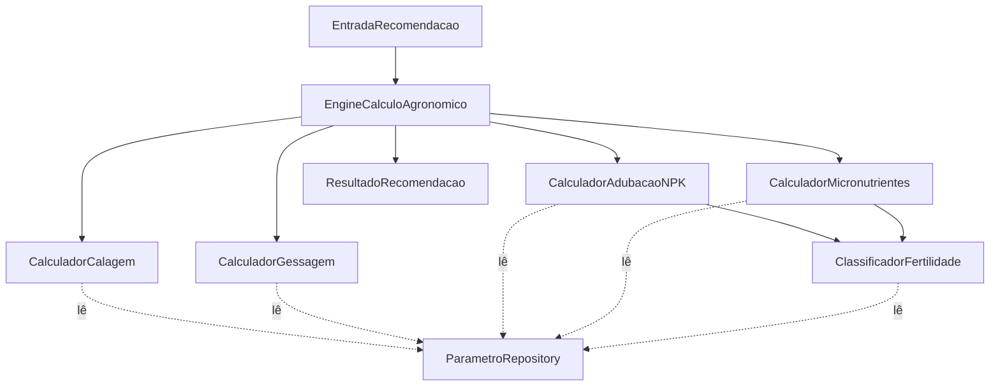
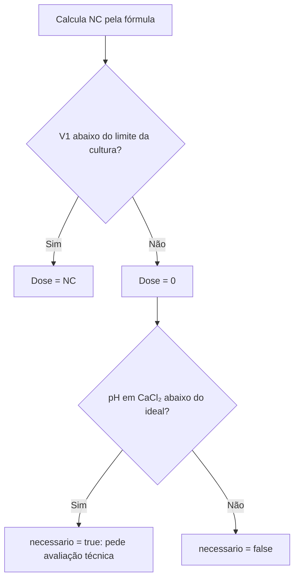
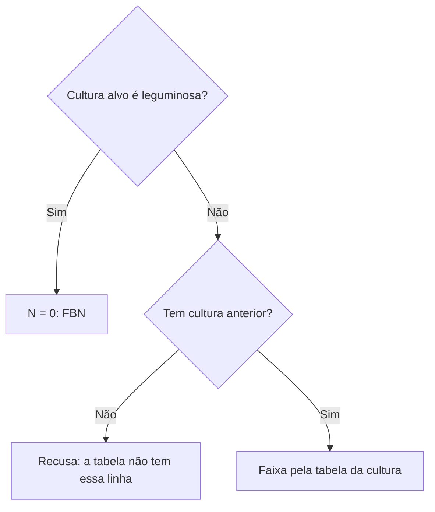
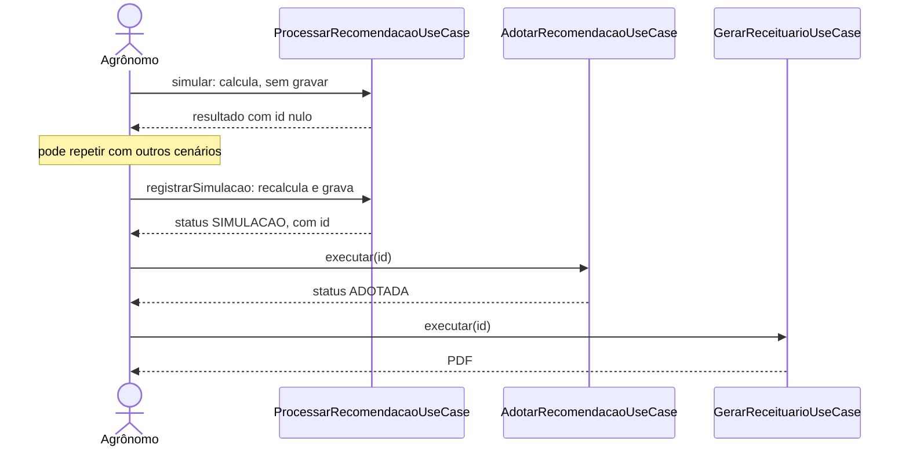

# Services

O projeto não tem classes chamadas `XxxService` no estilo comum do Spring. O que costuma ser chamado de "service" está dividido em dois lugares:

| Tipo | Onde | Papel | Conhece banco e permissões? |
|---|---|---|---|
| **Serviços de domínio** | `domain.service` | O motor: as contas agronômicas | Não. Só lê parâmetros por uma interface |
| **Casos de uso** | `application.usecase` | Cada operação do sistema, do início ao fim | Sim, por meio de interfaces |

Em resumo, o caso de uso busca os dados e verifica a permissão, o motor calcula e o caso de uso devolve ou grava o resultado.

Os valores dos exemplos vêm do manual, versão `NEPAR-2019.1`. A origem de cada um, por página, está em [`docs/dados-do-manual.md`](../../docs/dados-do-manual.md).

---

# Parte 1: motor de cálculo

## 1. Visão geral



## 2. `CalculadorAgronomico`: o padrão Strategy

```java
public interface CalculadorAgronomico<R> {
    R calcular(EntradaRecomendacao entrada, ParametroRepository parametros);
}
```

Todo cálculo implementa essa interface: recebe o cenário, lê as tabelas e devolve um resultado, sem guardar estado nem alterar a entrada. Com isso:

- cada cálculo pode ser testado isoladamente;
- um novo cálculo seria uma nova classe, sem alterar as outras;
- o motor pode receber implementações alternativas pelo construtor.

## 3. `EngineCalculoAgronomico`: o orquestrador

Único método público: `processar(entrada)`. Passos:

1. Lê a versão vigente. Se não houver, registra uma pendência.
2. Executa calagem, gessagem, adubação e micronutrientes.
3. Se algum cálculo lançar `ParametroAusenteException`, guarda as pendências e **continua** os demais.
4. Se houver pendências, lança uma única exceção com todas elas.
5. Se não houver, monta avisos, memória de cálculo e o resultado.

O passo 3 faz o usuário ver de uma vez tudo o que falta nas tabelas, sem precisar corrigir um item por vez.

Um cenário sem dose no manual é diferente de uma pendência: `CalculadorAdubacaoNPK` lança `RegraNegocioException`, que interrompe o cálculo na hora, com a explicação.

**Avisos gerados:**

| Situação | Aviso |
|---|---|
| Calagem necessária com dose zero (pH baixo, mas V1 não está abaixo do limite) | A justificativa da calagem |
| Gessagem não avaliada | A justificativa da gessagem |
| Teor de um micronutriente previsto no manual não informado no laudo | O nutriente que falta |

A memória de cálculo começa com SB, t, T, V1, m% e K na CTC, seguidos das linhas de calagem, gessagem, adubação e micronutrientes.

## 4. `CalculadorCalagem`

Calcula a necessidade de calcário pelo método da saturação por bases (manual, p. 50):

```text
NC (t/ha) = (V2 − V1) × T / PRNT
```

Como V1 = 100 × SB / T, o código usa a forma equivalente, que dispensa a divisão de V1:

```text
NC = (V2 × T − 100 × SB) / PRNT
```

Isso mantém a conta exata até a única divisão final.

### Regras

O manual dá dois números por cultura: o V2, a saturação a atingir, e um limite abaixo do qual o calcário é indicado.

| Cultura | Aplicar se V% estiver abaixo de | Elevar para (V2) |
|---|---|---|
| Soja | 50% | 60% |
| Milho | 60% | 70% |
| Trigo | 60% | 70% |



| Situação | `necessario` | Dose | Justificativa |
|---|---|---|---|
| V1 abaixo do limite | Sim | NC | "V1% atual (...) abaixo do limite de (...) da cultura: elevar para V2% de (...)." |
| V1 fora do limite e pH em CaCl₂ baixo | Sim | 0,00 | Pede avaliação técnica, pois o método não indica dose |
| V1 fora do limite e pH adequado ou medido em água | Não | 0,00 | "V1% atual (...) não está abaixo do limite de (...) da cultura." |

O pH em água não é comparado com o ideal, porque a Tabela 5.1 só o dá em CaCl₂.

O limite é comparado com o V1 exato, por meio de `LaudoSolo.saturacaoBasesAbaixoDe`. Assim, 49,98% aciona a calagem da soja, mesmo aparecendo como 50,0%.

Um V1 de 55% na soja mostra por que o limite importa: a fórmula daria 0,50 t/ha, mas o manual não indica calcário, porque 55% não está abaixo de 50%. O valor da fórmula fica em `ncCalculadaTonHa`, e a dose final, em `necessidadeCalcarioTonHa`.

O manual não traz teto de calagem. A forma de aplicação depende do manejo e vem de `RegraCalagem`.

### Exemplo resolvido

Laudo da Tela A: Ca 3,20; Mg 1,10; K 0,35; H+Al 4,80. PRNT = 100%.

```text
SB = 4,65    T = 9,45    V1 = 49,2%
```

| Cultura | V1 abaixo do limite? | Conta | Dose |
|---|---|---|---|
| Soja (V2 60%) | Sim: 49,2 < 50 | (60 × 9,45 − 100 × 4,65) / 100 = 1,02 | 1,02 t/ha |
| Milho (V2 70%) | Sim: 49,2 < 60 | (70 × 9,45 − 100 × 4,65) / 100 = 1,965 | 1,97 t/ha |
| Trigo (V2 70%) | Sim: 49,2 < 60 | Igual à do milho | 1,97 t/ha |

**Efeito do PRNT, na soja:** com PRNT 80, a dose passa a 102 / 80 = 1,28 t/ha (arredondado).

O método público `calcularNC(laudo, cultura, prnt)` é a parte exigida literalmente pelo teste da seção 10 do SRS, que recebe o V2 como parâmetro.

## 5. `CalculadorGessagem`

Avalia a camada de **20-40 cm** (manual, p. 56). Sem laudo dessa camada, devolve `avaliada = false` e dose zero, sem erro.

O gesso é indicado se **qualquer** critério for atendido:

| Critério | Limite |
|---|---|
| Saturação por alumínio (m%) maior que | 20% |
| Ca²⁺ menor que | 0,5 cmolc/dm³ |

A dose vem da tabela, pela argila da própria camada:

| Argila | Gesso (kg/ha) |
|---|---|
| Até 20% | 700 |
| Acima de 20% até 40% | 1.200 |
| Acima de 40% até 60% | 2.200 |
| Acima de 60% | 3.200 |

A comparação de m% usa o valor exato, por meio de `LaudoSolo.saturacaoAluminioAcimaDe`. Os valores exatamente no limite **não** acionam o critério.

### Exemplo resolvido

Gleba 02, laudo de 20-40 cm (id 7): Ca²⁺ 0,40; Mg²⁺ 0,20; K⁺ 0,07; Al³⁺ 0,70; argila 34%.

```text
SB = 0,67    t = 1,37    m% = 51,1
m%   51,1 > 20,0    acionado
Ca²⁺ 0,40 < 0,50    acionado
Argila de 34%: 1.200 kg/ha
```

Resposta real da justificativa: `Indicada na camada de 20-40 cm: m% 51,1% > 20,0%; Ca²⁺ 0,40 < 0,50 cmolc/dm³.`

## 6. `ClassificadorFertilidade`

Enquadra um valor em uma classe de fertilidade. Não implementa `CalculadorAgronomico`, porque é uma ferramenta usada por outros: `CalculadorAdubacaoNPK`, `CalculadorMicronutrientes` e os casos de uso de laudo.

| Atributo | Como é enquadrado | Tabela |
|---|---|---|
| Fósforo | Teor, conforme a faixa de argila | 3.3 |
| Potássio | **Porcentagem de K na CTC a pH 7,0**, não o teor | 3.4 |
| pH | Valor direto, na coluna do método informado no laudo (CaCl₂ ou H₂O) | 3.2 |
| Ca, Mg, V%, m%, M.O. | Valor direto | 3.2 |
| Zn, B, Cu e Mn | Teor | 3.5 |

| Método | Quando não há faixa | Uso |
|---|---|---|
| `interpretar(laudo)` | Devolve classe nula | Mostrar o laudo, em que a falta de classe não impede a exibição |
| `classeObrigatoria(laudo, atributo, teor)` | Lança `ParametroAusenteException` | Cálculo de dose, em que não se pode adivinhar |

Em ambos, se **mais de uma** faixa combinar, é lançada `ParametroAusenteException`: isso indica erro na tabela.

## 7. `CalculadorAdubacaoNPK`

As tabelas do manual dão a dose em **faixas**. O sistema mostra a faixa e não escolhe um valor dentro dela: essa definição cabe ao agrônomo.

Cada nutriente é procurado pela **sua própria** classe. Assim, um solo com P "Alto" e K "Muito alto" recebe cada dose pela linha correta. A célula é escolhida por cultura, nutriente, classe, cultura anterior (quando se aplica) e produtividade esperada.

| Nutriente | Soja | Milho | Trigo |
|---|---|---|---|
| P₂O₅ | Classe de P × produtividade | Igual | Igual |
| K₂O | Classe de K × produtividade | Igual | Igual |
| N | Zero, por FBN | Cultura anterior × produtividade | Cultura anterior × classe de M.O. × produtividade |

Precisa existir **exatamente uma** célula: nenhuma ou mais de uma gera pendência.

### Quando o cenário é recusado

O manual não traz dose nestes casos, e o sistema não inventa uma. A resposta é um erro 422 com a explicação:

| Situação | Mensagem real |
|---|---|
| Célula "Inviável" | Produtividade de 17,00 t/ha é inviável para Milho com P Baixo no solo, segundo o manual. |
| Milho ou trigo sem cultura anterior | O manual não traz dose de N para Milho sem cultura anterior: selecione uma gramínea ou uma leguminosa. |

### Nitrogênio



O crédito e o débito de N, descritos no TCC, já estão embutidos nas tabelas: a linha "Leguminosa" tem doses menores que a linha "Gramínea".

**Exemplo:** laudo da Tela A, com M.O. de 28,5 g/dm³ (2,85%, classe Alto).

| Cenário | Cultura anterior | N (kg/ha) |
|---|---|---|
| Milho, 9,5 t/ha | Soja (leguminosa) | 61 a 120 |
| Milho, 9,5 t/ha | Trigo (gramínea) | 121 a 180 |
| Trigo, 4,0 t/ha | Soja (leguminosa) | 51 a 80 |
| Soja, 4,5 t/ha | Qualquer | 0 |

**P₂O₅ e K₂O da soja, 4,5 t/ha:**

```text
P: teor 12,00 com argila de 45%     → classe Alto       → coluna 4,1 a 5 t/ha → 61 a 80 kg/ha
K: 0,35 / 9,45 = 3,7% da CTC        → classe Muito alto → coluna 4,1 a 5 t/ha → 50 a 70 kg/ha
```

## 8. `CalculadorMicronutrientes`

Avalia Zn, B, Cu e Mn pela classe do teor no solo (Tabelas 3.5 e 9.13). Abaixo do nível crítico, que o manual situa no início da classe Alto, aplica a dose; a partir dele, a dose é zero. Como os teores são opcionais no laudo e só a soja tem dose no manual, a falta de um ou outro não é erro. Toda dose de Mn traz na justificativa a restrição do manual: aplicar só com sintomas na planta.

| Situação | `avaliado` | `previstoNoManual` | Dose |
|---|---|---|---|
| Cultura sem dose no manual (milho e trigo) | Falso | Falso | Nula |
| Soja, teor não informado | Falso | Verdadeiro | Nula, com aviso |
| Soja, classes Muito baixo e Baixo | Verdadeiro | Verdadeiro | B 1,5 e Zn 2,0 kg/ha |
| Soja, classe Médio | Verdadeiro | Verdadeiro | B 1,0 e Zn 1,5 kg/ha |
| Soja, classe Alto ou superior | Verdadeiro | Verdadeiro | 0,00 |

A Tabela 9.13 começa em Baixo. Para Muito baixo, usa-se a dose dessa linha, decisão registrada na justificativa e na memória de cálculo.

---

# Parte 2: casos de uso

## 9. Como ler um caso de uso

Todos seguem o mesmo roteiro:

```java
public LaudoResponse executar(UsuarioAutenticado ator, LaudoRequest r) {
    ContextoTalhao contexto = talhoes.contexto(r.talhaoId())               // 1. busca o dado
            .orElseThrow(() -> new RecursoNaoEncontradoException(...));
    acesso.exigirAcessoAoProdutor(ator, contexto.produtorId());            // 2. verifica o acesso
    LaudoSolo laudo = new LaudoSolo(...);                                  // 3. o domínio valida
    LaudoSolo salvo = laudos.salvar(laudo);                                // 4. grava
    return LaudoResponse.de(salvo, contexto, ...);                         // 5. monta a resposta
}
```

## 10. `ControleAcesso`

É consultado por quase todos os casos de uso. Tem `@UseCase` para ser registrado como bean, embora não seja uma operação do usuário.

| Método | O que faz |
|---|---|
| `escopo(ator)` | Devolve os produtores visíveis: todos para o administrador, os vinculados para o agrônomo, ele mesmo para o produtor |
| `exigirAcessoAoProdutor(ator, produtorId)` | Lança `AcessoNegadoException` se o produtor estiver fora do escopo |
| `exigirPerfil(ator, perfis...)` | Lança `AcessoNegadoException` se o perfil não estiver na lista |

## 11. Autenticação e usuários

### `AutenticarUsuarioUseCase`

| Método | O que faz |
|---|---|
| `executar(LoginRequest)` | Normaliza o e-mail (sem espaços, em minúsculas), confere a senha e emite o token. E-mail inexistente e senha errada geram o mesmo erro, para não revelar quais e-mails existem |
| `emitirToken(usuario)` | Gera o token e monta `TokenResponse`. Também é usado no registro |

### `RegistrarUsuarioUseCase`

Cadastro público. Recusa o perfil `ADMIN`, cria a conta e já devolve o token, deixando o usuário autenticado.

### `CriarContaUsuario`

Regra comum aos três caminhos de criação de conta: registro público, criação por usuário autorizado e administrador inicial. Normaliza o e-mail, recusa duplicidade (`ConflitoException`) e cifra a senha.

### `GerenciarUsuariosUseCase`

| Método | Quem pode | Regras |
|---|---|---|
| `meuPerfil` | Qualquer autenticado | Dados da própria conta |
| `listar` | Admin e agrônomo | O admin vê todos, com filtro opcional por perfil. O agrônomo vê seus produtores, e o filtro é ignorado |
| `criar` | Admin e agrônomo | O agrônomo só cria produtor, e fica vinculado automaticamente a ele |
| `atualizar` | O próprio usuário ou o admin | Senha vazia mantém a atual. E-mail duplicado gera conflito. O perfil não muda |
| `excluir` | Admin | Não exclui a própria conta nem produtor com propriedades. Um agrônomo com recomendações é barrado pelas chaves estrangeiras, com resposta 409 |

### `GerenciarVinculosUseCase`

O acesso de um agrônomo nasce do **consentimento**.

| Método | Produtor | Agrônomo | Admin |
|---|---|---|---|
| `listar` | Seus agrônomos | Seus produtores | Todos os vínculos |
| `vincular` | Autoriza pelo e-mail do agrônomo | **Recusado** | Informa `agronomoId` e `produtorId` |
| `desvincular` | Os próprios | Os próprios | Qualquer um |

O agrônomo tem acesso a um produtor de três formas: o produtor o autoriza, ele mesmo cadastra o produtor ou o administrador faz o vínculo.

## 12. Propriedades e talhões

### `GerenciarPropriedadesUseCase`

| Método | Regras |
|---|---|
| `listar` | Propriedades no escopo, com nome do produtor, quantidade de talhões e área total |
| `detalhar` | Exige acesso |
| `criar` | Para o produtor, o dono é ele mesmo, e o `produtorId` enviado é ignorado. Para os demais, o `produtorId` é obrigatório, deve estar no escopo e ter perfil de produtor. A UF é sempre PR |
| `atualizar` | Altera nome e município; o dono não muda |
| `excluir` | Recusa se houver talhões |

### `GerenciarTalhoesUseCase`

| Método | Regras |
|---|---|
| `listar` | Talhões no escopo, com filtro opcional por propriedade |
| `detalhar` | Exige acesso |
| `criar` | Exige acesso à propriedade. Identificação repetida na propriedade gera conflito, com a identificação na mensagem |
| `atualizar` | Altera identificação, área e textura, com a mesma verificação de repetição |
| `excluir` | Recusa se houver laudos |

## 13. Laudos

| Classe | O que faz |
|---|---|
| `CadastrarLaudoUseCase` | Verifica o acesso ao talhão, cria o `LaudoSolo` (que se valida), grava e devolve com a interpretação |
| `ConsultarLaudosUseCase` | `listar` traz os laudos do escopo, com `interpretacao` vazia para economizar. `detalhar` traz o enquadramento completo |
| `ExcluirLaudoUseCase` | Recusa se o laudo já foi usado em recomendações, porque o histórico não pode perder a origem |
| `CalcularIndicadoresUseCase` | Calcula SB, t, T, V% e m% para a prévia da tela. Não acessa o banco. Assim, as fórmulas ficam só no domínio, sem cópia no Angular |

## 14. Recomendações: o fluxo principal



### `ProcessarRecomendacaoUseCase`

| Método | Quem pode | O que faz |
|---|---|---|
| `simular` | Agrônomo e admin | Monta a entrada, roda o motor e devolve o resultado. **Não grava nada** (RF05) |
| `registrarSimulacao` | Agrônomo | Faz o mesmo e grava com status `SIMULACAO` |

O passo interno `montarEntrada`:

1. busca o laudo e verifica o acesso ao produtor;
2. busca as culturas alvo e antecessora;
3. usa PRNT 100 se nenhum valor for informado (manual, p. 51);
4. procura o laudo de 20-40 cm **do mesmo talhão com a data mais próxima**.

**O servidor sempre recalcula ao registrar.** Ele não aceita resultado enviado pelo cliente, de modo que a adoção sempre parte de um cálculo confiável.

Enviar um laudo de 20-40 cm como base gera 422, pela validação de `EntradaRecomendacao`.

### `AdotarRecomendacaoUseCase`

Exclusivo do agrônomo com acesso ao produtor. A adoção é a decisão técnica: chama `Recomendacao.adotar`, que recusa uma segunda adoção, e grava autor e data. O resultado salvo **não é recalculado**.

### `ConsultarRecomendacoesUseCase`

| Método | Regras |
|---|---|
| `listar` | No escopo do usuário. Para o produtor, o filtro de status é forçado para `ADOTADA` |
| `detalhar` | Exige acesso. O produtor recebe **404** ao pedir uma simulação, como se ela não existisse |
| `excluir` | Só o agrônomo. Descarta simulação; recomendação adotada gera conflito |
| `sugerirAntecessora` | Cultura da última recomendação adotada no talhão |

### `MontadorRecomendacao`

Converte o cenário e o resultado em `RecomendacaoResponseDTO`. Tem dois modos:

- `simulacao`: id nulo, sem responsável;
- `registrada`: com id, datas e responsável, que é quem adotou ou, se ainda não houve adoção, quem gerou.

## 15. Relatório, histórico e painel

| Classe | O que faz |
|---|---|
| `GerarReceituarioUseCase` | Usa `ConsultarRecomendacoesUseCase.detalhar`, herdando as regras de acesso. Recusa recomendação não adotada com 422 e chama `GeradorReceituario` |
| `ConsultarHistoricoTalhaoUseCase` | Junta laudos e recomendações adotadas do período em uma linha do tempo, do mais recente ao mais antigo. Simulações ficam de fora |
| `GerarDashboardEvolucaoUseCase` | Séries em ordem cronológica: pontos com os laudos de 0-20 cm e a lista de adoções |
| `GerarResumoPainelUseCase` | Contagens, área total, os 5 laudos e as 5 recomendações mais recentes e os talhões sem laudo. Para o produtor, considera só as adotadas |
| `ConsultarParametrosUseCase` | Mostra a versão vigente, as culturas e todas as tabelas, além das contas de demonstração para `/sistema/info` |

---

# Parte 3: serviços externos

Os casos de uso usam estas interfaces, sem saber qual tecnologia está por trás:

| Porta | Implementação | Comportamento |
|---|---|---|
| `CifradorSenha` | BCrypt, em `SenhaConfig` | `cifrar` gera o hash, e `confere` compara a senha com ele |
| `GeradorToken` | Nimbus, em `JwtConfig` | Gera o JWT com id, perfil e validade |
| `GeradorReceituario` | `OpenPdfGeradorReceituario` | Recebe o DTO da recomendação e devolve os bytes do PDF |
| `ModoDemonstracao` | `ModoDemonstracaoConfig` | Lista de contas de exemplo, vazia fora do perfil `demo` |

### O receituário em PDF

`OpenPdfGeradorReceituario` monta, nesta ordem:

1. título e base normativa, com número, data e versão dos parâmetros;
2. aviso de "DOCUMENTO DE TESTE", se a versão usada não foi conferida com o manual, como nas recomendações antigas da `DEMO-2026.1`;
3. identificação: produtor, propriedade, talhão, cultura, antecessora, manejo e rendimento;
4. dados do laudo;
5. recomendação proposta: dose por hectare e total no talhão (dose × área). N, P₂O₅ e K₂O aparecem em faixa;
6. justificativas e avisos, com a nota de que a definição dentro da faixa cabe ao responsável técnico;
7. assinatura do responsável, com o CREA, se houver;
8. memória de cálculo.

As fontes padrão do PDF não têm alguns símbolos. O método `texto` troca, por exemplo, `P₂O₅` por `P2O5`.

### Carga inicial

| Classe | Quando roda | O que faz |
|---|---|---|
| `AdministradorInicial` | Em toda inicialização | Cria o administrador se `ADMIN_EMAIL` e `ADMIN_PASSWORD` estiverem definidos e não houver outro |
| `DemoDataLoader` | No perfil `demo`, com banco sem os dados de demonstração | Cria contas, propriedades, laudos e recomendações fictícios. As doses saem do motor real, sobre as tabelas do manual |

`DemoDataLoader` usa o laudo de 20-40 cm mais recente do talhão, enquanto `ProcessarRecomendacaoUseCase` usa o de data mais próxima. Nos dados de demonstração, cada talhão tem no máximo um laudo dessa camada, então o resultado é o mesmo.

## Onde cada requisito é atendido

| Requisito | Classe principal |
|---|---|
| RF01: login e perfis | `AutenticarUsuarioUseCase`, `SecurityConfig` |
| RF02: propriedades e talhões | `GerenciarPropriedadesUseCase`, `GerenciarTalhoesUseCase` |
| RF03: laudo | `CadastrarLaudoUseCase`, `LaudoSolo` |
| RF04: interpretação | `IndicadoresSolo`, `ClassificadorFertilidade` |
| RF05: simulação em memória | `ProcessarRecomendacaoUseCase.simular`, `EngineCalculoAgronomico` |
| RF06: adoção | `AdotarRecomendacaoUseCase`, `Recomendacao.adotar` |
| RF07: histórico | `ConsultarHistoricoTalhaoUseCase`, `GerarDashboardEvolucaoUseCase` |
| RF08: receituário | `GerarReceituarioUseCase`, `OpenPdfGeradorReceituario` |
| RNF01: domínio puro | `ArquiteturaTest` |
| RNF02: parâmetros no banco | `ParametroRepository`, `ParametroRepositoryJpa` |
| RNF03: `BigDecimal` | `Decimais`, `ArquiteturaTest` |
| RNF04: desempenho | Teste `desempenhoDaSimulacao` |
| RNF05: controle de acesso | `ControleAcesso` |
| RNF06: auditoria | `snapshot_auditoria`, `RecomendacaoRepositoryImpl`, `trg_recomendacao_imutavel` |
