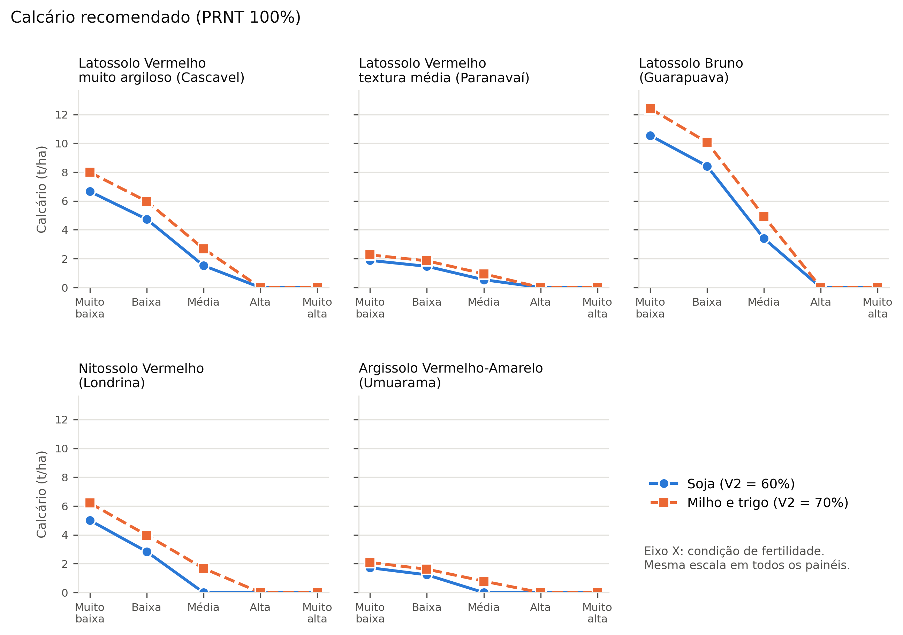
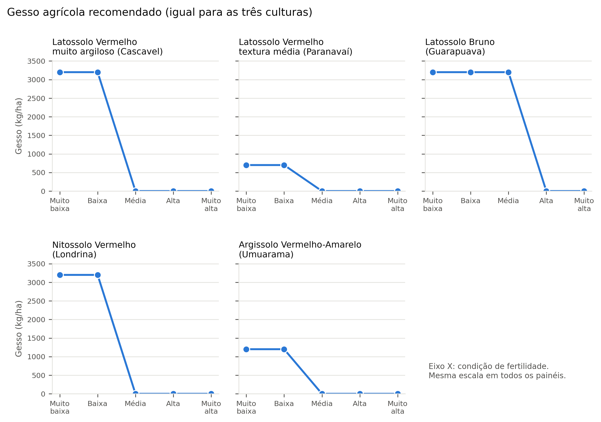
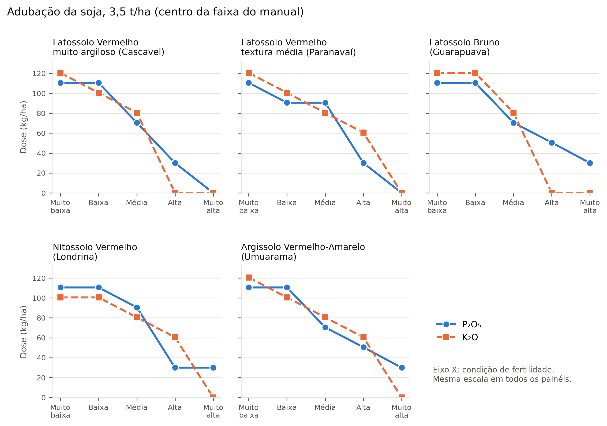

# Validação com laudos sintéticos

Sem laudos reais disponíveis para a validação, montei laudos **sintéticos**: valores criados por mim para representar os
principais solos agrícolas do Paraná, em cinco condições de fertilidade. Não são medições de campo. Servem para conferir se o
sistema aplica as regras do manual corretamente em solos com características bem diferentes entre si.

## Os solos

Os Latossolos, Argissolos e Nitossolos ocupam juntos cerca de 61% da área mapeada do Paraná (Latossolos 30,76%,
Argissolos 15,53% e Nitossolos 15,18%, segundo Bhering et al., 2008, citados na apostila de Pedologia da UFPR). Os
Neossolos (22,2%) e os Cambissolos (10,63%) ficaram de fora: são rasos e ocorrem sobretudo em relevo movimentado, pouco
usado para soja, milho e trigo mecanizados.

Usei três Latossolos porque, sob a mesma ordem, há solos que o motor trata de forma muito diferente:

| Solo | Região | Material de origem | O que ele testa no sistema |
|---|---|---|---|
| Latossolo Vermelho eutroférrico muito argiloso | Oeste (Cascavel) | Basalto | Argila acima de 40% na tabela de fósforo e CTC alta |
| Nitossolo Vermelho eutroférrico | Norte (Londrina) | Basalto | Solo fértil por natureza: na condição média, a soja já não pede calcário |
| Latossolo Vermelho distrófico textura média | Noroeste (Paranavaí) | Arenito Caiuá | Argila abaixo de 25%, CTC baixa, pouca matéria orgânica |
| Latossolo Bruno alumínico | Centro-Sul (Guarapuava) | Basalto e rochas ácidas | Muito alumínio e matéria orgânica: gessagem e N do trigo |
| Argissolo Vermelho-Amarelo | Noroeste (Umuarama) | Arenito Caiuá | Mais argila na camada de 20-40 cm do que na de 0-20 cm |

Os valores seguem a classificação de cada solo (eutrófico com V% alto, distrófico com V% baixo, alumínico com Al alto) e os
dados publicados que encontrei: um Nitossolo Vermelho de Londrina com 79% de argila e V% de 66%; um Latossolo Bruno
alumínico de Guarapuava com V% de 25% e Al de 1,27 cmolc/dm³ na camada de 0-20 cm, sem calcário; e um Argissolo do arenito
Caiuá, em Umuarama, com 86% de areia.

## As condições de fertilidade

Cada solo aparece em cinco condições, que representam o histórico da área:

| Condição | O que representa | Como é o laudo |
|---|---|---|
| Muito baixa | Área recém-aberta, nunca corrigida | V% muito baixo, alumínio muito alto, P e K em Muito baixo |
| Baixa | Área degradada | V% baixo, alumínio alto, P e K em Muito baixo ou Baixo |
| Média | Área em correção | V% perto do limite da cultura, P e K em Baixo ou Médio |
| Alta | Fertilidade construída, plantio direto consolidado | V% acima do limite, sem alumínio, P e K em Alto ou Muito alto |
| Muito alta | Adubação acima do necessário por anos | V% acima de 75%, pH acima do ideal, P e K em Muito alto ou Condição a evitar |

Cada condição tem um laudo de 0-20 cm e um de 20-40 cm: são 5 solos × 5 condições × 2 camadas = **50 laudos**. Cada um foi
simulado para as três culturas, com plantio direto e calcário de PRNT 100%: soja de 3,5 t/ha após trigo, milho de 7,5 t/ha
após soja e trigo de 3,0 t/ha após soja. São **75 recomendações**.

## Como a validação funciona

1. Os laudos estão em [`laudos-sinteticos.csv`](../TCC-BACK/src/main/resources/validacao/laudos-sinteticos.csv).
2. [`referencia_laudos_sinteticos.py`](validacao/referencia_laudos_sinteticos.py) calcula o resultado esperado sem usar o
   sistema: as tabelas do manual estão transcritas no próprio script, a partir de [`dados-do-manual.md`](dados-do-manual.md),
   e não lidas do banco. O resultado vai para
   [`referencia-laudos-sinteticos.csv`](../TCC-BACK/src/test/resources/validacao/referencia-laudos-sinteticos.csv).
3. `LaudosSinteticosIntegracaoTest` cadastra cada laudo pela API, simula as três culturas e compara a resposta com a
   referência: SB, CTC, V%, calcário, gesso, classes de P, K e M.O., faixas de N, P₂O₅ e K₂O e as doses de Zn, B, Cu e Mn.

**Resultado: as 75 recomendações do sistema são iguais às da referência.** Para conferir que o teste detecta erros, alterei
de propósito dois valores esperados (o calcário de um cenário e o manganês de outro), e os dois casos falharam.

Os laudos também ficam salvos no sistema, no modo demonstração: o produtor "Área de Validação (laudos sintéticos)", vinculado
à agrônoma de exemplo, tem uma propriedade por solo e um talhão por condição, cada um com os dois laudos e as três
simulações registradas.

## Gráficos

Gerados por [`graficos_laudos_sinteticos.py`](validacao/graficos_laudos_sinteticos.py), com um painel por solo: os três
Latossolos em cima e o Nitossolo e o Argissolo embaixo. Como o teste confirma que o
sistema dá os mesmos valores da referência, eles mostram também a saída do FertSolo.



Cada painel é um solo, todos na mesma escala. O calcário cai conforme a fertilidade melhora, e a altura de cada painel
mostra que a dose depende da CTC. O Latossolo
Bruno, com CTC de 18,6 cmolc/dm³ e V% de 3,4% na condição muito baixa, pede 12,4 t/ha para milho e trigo. No plantio
direto consolidado, o manual permite parcelar a dose em até três anos (p. 55). Os solos arenosos do
noroeste, com CTC perto de 4, pedem menos de 2 t/ha mesmo degradados. Na condição média, o Nitossolo e o Argissolo já estão
acima do limite de 50% da soja e não recebem calcário para ela, mas recebem para milho e trigo, cujo limite é 60%.



O gesso só aparece quando a camada de 20-40 cm tem saturação por alumínio acima de 20% ou cálcio abaixo de 0,5 cmolc/dm³, e a
dose sai da argila dessa camada. O Latossolo Vermelho e o Nitossolo, muito argilosos, recebem a dose máxima (3.200 kg/ha).
O Latossolo Bruno continua pedindo gesso na condição média, por causa do alumínio em profundidade. O Argissolo recebe mais
gesso que o Latossolo de textura média porque tem mais argila na camada de baixo (30% contra 18%).



As doses de P₂O₅ e K₂O dependem da classe do nutriente, e o gráfico mostra o centro da faixa do manual. Com o mesmo teor de
fósforo, a classe muda com a argila: na condição baixa, 7 mg/dm³ de P no Latossolo de textura média é Baixo, enquanto 2,5
mg/dm³ no Latossolo muito argiloso é Muito baixo. Na condição muito alta, o fósforo do Latossolo muito argiloso (70 mg/dm³) e
do Latossolo de textura média (130 mg/dm³) passa do limite da "Condição a evitar", e o sistema não recomenda P₂O₅. No
potássio, a classe vem da porcentagem de K na CTC; por isso os solos arenosos chegam à condição alta ainda com K Alto, e não
Muito alto, e continuam recebendo K₂O.

## Resultados

**Soja, 3,5 t/ha**

| Solo | Condição | V1 (%) | Calcário (t/ha) | Gesso (kg/ha) | Classe P | Classe K | N (kg/ha) | P₂O₅ (kg/ha) | K₂O (kg/ha) |
|---|---|---|---|---|---|---|---|---|---|
| LV muito argiloso | Muito baixa | 10,2 | 6,66 | 3.200 | Muito baixo | Muito baixo | 0 | 101 a 120 | 111 a 130 |
| LV muito argiloso | Baixa | 21,8 | 4,74 | 3.200 | Muito baixo | Baixo | 0 | 101 a 120 | 91 a 110 |
| LV muito argiloso | Média | 47,0 | 1,52 | 0 | Médio | Médio | 0 | 61 a 80 | 71 a 90 |
| LV muito argiloso | Alta | 69,0 | 0,00 | 0 | Muito alto | Muito alto | 0 | 20 a 40 | 0 |
| LV muito argiloso | Muito alta | 81,6 | 0,00 | 0 | Condição a evitar | Muito alto | 0 | 0 | 0 |
| Nitossolo | Muito baixa | 18,1 | 5,01 | 3.200 | Muito baixo | Baixo | 0 | 101 a 120 | 91 a 110 |
| Nitossolo | Baixa | 35,1 | 2,84 | 3.200 | Muito baixo | Baixo | 0 | 101 a 120 | 91 a 110 |
| Nitossolo | Média | 54,9 | 0,00 | 0 | Baixo | Médio | 0 | 81 a 100 | 71 a 90 |
| Nitossolo | Alta | 72,6 | 0,00 | 0 | Muito alto | Alto | 0 | 20 a 40 | 51 a 70 |
| Nitossolo | Muito alta | 83,7 | 0,00 | 0 | Muito alto | Muito alto | 0 | 20 a 40 | 0 |
| LV textura média | Muito baixa | 10,8 | 1,88 | 700 | Muito baixo | Muito baixo | 0 | 101 a 120 | 111 a 130 |
| LV textura média | Baixa | 21,7 | 1,47 | 700 | Baixo | Baixo | 0 | 81 a 100 | 91 a 110 |
| LV textura média | Média | 47,1 | 0,54 | 0 | Baixo | Médio | 0 | 81 a 100 | 71 a 90 |
| LV textura média | Alta | 66,1 | 0,00 | 0 | Muito alto | Alto | 0 | 20 a 40 | 51 a 70 |
| LV textura média | Muito alta | 78,2 | 0,00 | 0 | Condição a evitar | Muito alto | 0 | 0 | 0 |
| Latossolo Bruno | Muito baixa | 3,4 | 10,54 | 3.200 | Muito baixo | Muito baixo | 0 | 101 a 120 | 111 a 130 |
| Latossolo Bruno | Baixa | 8,8 | 8,42 | 3.200 | Muito baixo | Muito baixo | 0 | 101 a 120 | 111 a 130 |
| Latossolo Bruno | Média | 37,7 | 3,40 | 3.200 | Médio | Médio | 0 | 61 a 80 | 71 a 90 |
| Latossolo Bruno | Alta | 61,4 | 0,00 | 0 | Alto | Muito alto | 0 | 41 a 60 | 0 |
| Latossolo Bruno | Muito alta | 75,7 | 0,00 | 0 | Muito alto | Muito alto | 0 | 20 a 40 | 0 |
| Argissolo | Muito baixa | 13,7 | 1,72 | 1.200 | Muito baixo | Muito baixo | 0 | 101 a 120 | 111 a 130 |
| Argissolo | Baixa | 28,8 | 1,23 | 1.200 | Muito baixo | Baixo | 0 | 101 a 120 | 91 a 110 |
| Argissolo | Média | 52,1 | 0,00 | 0 | Médio | Médio | 0 | 61 a 80 | 71 a 90 |
| Argissolo | Alta | 66,9 | 0,00 | 0 | Alto | Alto | 0 | 41 a 60 | 51 a 70 |
| Argissolo | Muito alta | 80,9 | 0,00 | 0 | Muito alto | Muito alto | 0 | 20 a 40 | 0 |

**Milho, 7,5 t/ha**

| Solo | Condição | V1 (%) | Calcário (t/ha) | Gesso (kg/ha) | Classe P | Classe K | N (kg/ha) | P₂O₅ (kg/ha) | K₂O (kg/ha) |
|---|---|---|---|---|---|---|---|---|---|
| LV muito argiloso | Muito baixa | 10,2 | 7,99 | 3.200 | Muito baixo | Muito baixo | 20 a 60 | 111 a 130 | 101 a 130 |
| LV muito argiloso | Baixa | 21,8 | 5,98 | 3.200 | Muito baixo | Baixo | 20 a 60 | 111 a 130 | 71 a 100 |
| LV muito argiloso | Média | 47,0 | 2,69 | 0 | Médio | Médio | 20 a 60 | 71 a 90 | 41 a 70 |
| LV muito argiloso | Alta | 69,0 | 0,00 | 0 | Muito alto | Muito alto | 20 a 60 | 30 a 50 | 20 |
| LV muito argiloso | Muito alta | 81,6 | 0,00 | 0 | Condição a evitar | Muito alto | 20 a 60 | 0 | 20 |
| Nitossolo | Muito baixa | 18,1 | 6,21 | 3.200 | Muito baixo | Baixo | 20 a 60 | 111 a 130 | 71 a 100 |
| Nitossolo | Baixa | 35,1 | 3,98 | 3.200 | Muito baixo | Baixo | 20 a 60 | 111 a 130 | 71 a 100 |
| Nitossolo | Média | 54,9 | 1,68 | 0 | Baixo | Médio | 20 a 60 | 91 a 110 | 41 a 70 |
| Nitossolo | Alta | 72,6 | 0,00 | 0 | Muito alto | Alto | 20 a 60 | 30 a 50 | 21 a 40 |
| Nitossolo | Muito alta | 83,7 | 0,00 | 0 | Muito alto | Muito alto | 20 a 60 | 30 a 50 | 20 |
| LV textura média | Muito baixa | 10,8 | 2,26 | 700 | Muito baixo | Muito baixo | 20 a 60 | 111 a 130 | 101 a 130 |
| LV textura média | Baixa | 21,7 | 1,85 | 700 | Baixo | Baixo | 20 a 60 | 91 a 110 | 71 a 100 |
| LV textura média | Média | 47,1 | 0,95 | 0 | Baixo | Médio | 20 a 60 | 91 a 110 | 41 a 70 |
| LV textura média | Alta | 66,1 | 0,00 | 0 | Muito alto | Alto | 20 a 60 | 30 a 50 | 21 a 40 |
| LV textura média | Muito alta | 78,2 | 0,00 | 0 | Condição a evitar | Muito alto | 20 a 60 | 0 | 20 |
| Latossolo Bruno | Muito baixa | 3,4 | 12,41 | 3.200 | Muito baixo | Muito baixo | 20 a 60 | 111 a 130 | 101 a 130 |
| Latossolo Bruno | Baixa | 8,8 | 10,07 | 3.200 | Muito baixo | Muito baixo | 20 a 60 | 111 a 130 | 101 a 130 |
| Latossolo Bruno | Média | 37,7 | 4,93 | 3.200 | Médio | Médio | 20 a 60 | 71 a 90 | 41 a 70 |
| Latossolo Bruno | Alta | 61,4 | 0,00 | 0 | Alto | Muito alto | 20 a 60 | 51 a 70 | 20 |
| Latossolo Bruno | Muito alta | 75,7 | 0,00 | 0 | Muito alto | Muito alto | 20 a 60 | 30 a 50 | 20 |
| Argissolo | Muito baixa | 13,7 | 2,09 | 1.200 | Muito baixo | Muito baixo | 20 a 60 | 111 a 130 | 101 a 130 |
| Argissolo | Baixa | 28,8 | 1,62 | 1.200 | Muito baixo | Baixo | 20 a 60 | 111 a 130 | 71 a 100 |
| Argissolo | Média | 52,1 | 0,79 | 0 | Médio | Médio | 20 a 60 | 71 a 90 | 41 a 70 |
| Argissolo | Alta | 66,9 | 0,00 | 0 | Alto | Alto | 20 a 60 | 51 a 70 | 21 a 40 |
| Argissolo | Muito alta | 80,9 | 0,00 | 0 | Muito alto | Muito alto | 20 a 60 | 30 a 50 | 20 |

**Trigo, 3,0 t/ha**

| Solo | Condição | V1 (%) | Calcário (t/ha) | Gesso (kg/ha) | Classe P | Classe K | N (kg/ha) | P₂O₅ (kg/ha) | K₂O (kg/ha) |
|---|---|---|---|---|---|---|---|---|---|
| LV muito argiloso | Muito baixa | 10,2 | 7,99 | 3.200 | Muito baixo | Muito baixo | 31 a 50 | 61 a 80 | 51 a 60 |
| LV muito argiloso | Baixa | 21,8 | 5,98 | 3.200 | Muito baixo | Baixo | 31 a 50 | 61 a 80 | 41 a 50 |
| LV muito argiloso | Média | 47,0 | 2,69 | 0 | Médio | Médio | 31 a 50 | 41 a 50 | 31 a 40 |
| LV muito argiloso | Alta | 69,0 | 0,00 | 0 | Muito alto | Muito alto | 31 a 40 | 31 a 40 | 10 a 20 |
| LV muito argiloso | Muito alta | 81,6 | 0,00 | 0 | Condição a evitar | Muito alto | 31 a 40 | 0 | 10 a 20 |
| Nitossolo | Muito baixa | 18,1 | 6,21 | 3.200 | Muito baixo | Baixo | 51 a 70 | 61 a 80 | 41 a 50 |
| Nitossolo | Baixa | 35,1 | 3,98 | 3.200 | Muito baixo | Baixo | 31 a 50 | 61 a 80 | 41 a 50 |
| Nitossolo | Média | 54,9 | 1,68 | 0 | Baixo | Médio | 31 a 50 | 51 a 60 | 31 a 40 |
| Nitossolo | Alta | 72,6 | 0,00 | 0 | Muito alto | Alto | 31 a 50 | 31 a 40 | 21 a 30 |
| Nitossolo | Muito alta | 83,7 | 0,00 | 0 | Muito alto | Muito alto | 31 a 40 | 31 a 40 | 10 a 20 |
| LV textura média | Muito baixa | 10,8 | 2,26 | 700 | Muito baixo | Muito baixo | 51 a 70 | 61 a 80 | 51 a 60 |
| LV textura média | Baixa | 21,7 | 1,85 | 700 | Baixo | Baixo | 51 a 70 | 51 a 60 | 41 a 50 |
| LV textura média | Média | 47,1 | 0,95 | 0 | Baixo | Médio | 51 a 70 | 51 a 60 | 31 a 40 |
| LV textura média | Alta | 66,1 | 0,00 | 0 | Muito alto | Alto | 51 a 70 | 31 a 40 | 21 a 30 |
| LV textura média | Muito alta | 78,2 | 0,00 | 0 | Condição a evitar | Muito alto | 51 a 70 | 0 | 10 a 20 |
| Latossolo Bruno | Muito baixa | 3,4 | 12,41 | 3.200 | Muito baixo | Muito baixo | 31 a 40 | 61 a 80 | 51 a 60 |
| Latossolo Bruno | Baixa | 8,8 | 10,07 | 3.200 | Muito baixo | Muito baixo | 31 a 40 | 61 a 80 | 51 a 60 |
| Latossolo Bruno | Média | 37,7 | 4,93 | 3.200 | Médio | Médio | 31 a 40 | 41 a 50 | 31 a 40 |
| Latossolo Bruno | Alta | 61,4 | 0,00 | 0 | Alto | Muito alto | 31 a 40 | 31 a 40 | 10 a 20 |
| Latossolo Bruno | Muito alta | 75,7 | 0,00 | 0 | Muito alto | Muito alto | 31 a 40 | 31 a 40 | 10 a 20 |
| Argissolo | Muito baixa | 13,7 | 2,09 | 1.200 | Muito baixo | Muito baixo | 51 a 70 | 61 a 80 | 51 a 60 |
| Argissolo | Baixa | 28,8 | 1,62 | 1.200 | Muito baixo | Baixo | 51 a 70 | 61 a 80 | 41 a 50 |
| Argissolo | Média | 52,1 | 0,79 | 0 | Médio | Médio | 51 a 70 | 41 a 50 | 31 a 40 |
| Argissolo | Alta | 66,9 | 0,00 | 0 | Alto | Alto | 51 a 70 | 31 a 40 | 21 a 30 |
| Argissolo | Muito alta | 80,9 | 0,00 | 0 | Muito alto | Muito alto | 51 a 70 | 31 a 40 | 10 a 20 |

As doses de micronutrientes da soja estão no CSV de referência. Milho e trigo não têm dose de micronutriente no manual.

## Limites desta validação

- Os laudos são sintéticos. Confirmam que o sistema segue o manual, mas não substituem a comparação com laudos reais e com a
  recomendação de um agrônomo.
- Escolhi rendimentos que não caem em "Inviável" em nenhuma condição, para que todas as recomendações tenham dose. Os casos de
  recusa estão cobertos por `ManualNeparIntegracaoTest`.
- Os valores evitam os limites exatos entre classes; esses limites estão cobertos por `CasosControleTest` e pelos testes do
  motor.

## Para gerar de novo

```bash
python docs/validacao/referencia_laudos_sinteticos.py
python docs/validacao/graficos_laudos_sinteticos.py
cd TCC-BACK
./mvnw test -Dtest=LaudosSinteticosIntegracaoTest
```

## Fontes

- Bhering et al. (2008), mapa de solos do Paraná, citado em: Oliveira Junior, J. C. Apostila de Pedologia. UFPR, 2021:
  <https://pedologia.ufpr.br/wp-content/uploads/2022/04/apostila-2021-2.pdf>
- Seidel, E. P. et al. Principais solos da mesorregião Oeste do Paraná. NEPAR/SBCS, 2023:
  <https://sbcs-nepar.org.br/wp-content/uploads/2023/11/Cartilha-solos-oeste-PR-versao-final.pdf>
- Carvalho, A. P. Solos do Arenito Caiuá. Embrapa:
  <https://www.alice.cnptia.embrapa.br/alice/bitstream/doc/303452/1/CARVALHO-A.-P.-Solos-do-Arenito-Caiua.pdf>
- Manejo da calagem e os componentes da acidez de Latossolo Bruno em plantio direto. Revista Brasileira de Ciência do Solo,
  v. 28, n. 2, 2004: <https://www.scielo.br/j/rbcs/a/yzjzB6Kqjjgkdpqqw4MxwsQ/?lang=pt>
- Classificação de solos e sugestão de uso: o caso do Estrato Superior da minibacia do riacho Cambé, Londrina, PR. Sinageo,
  2012: <https://www.sinageo.org.br/2012/trabalhos/6/6-226-353.html>
- Soybean cropping systems on sandy soil of the Caiuá Sandstone formation in Northwestern Paraná:
  <https://www.researchgate.net/publication/346327049>
